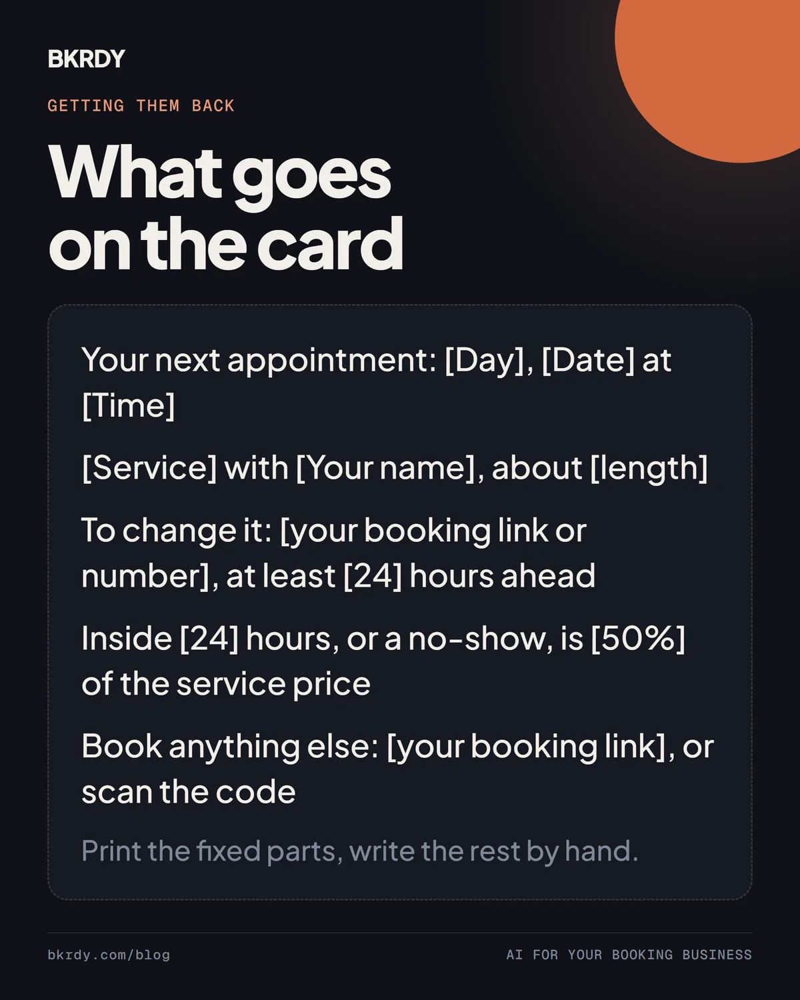

The small printed card you hand over at checkout still does a job nothing on a phone does as well. It turns "see you in three weeks" into a date, a time and a promise, while the client is still standing in front of you.

It matters most for the next appointment you book in the chair. That booking was made out loud, so there is no screen the client looked at and nothing they typed. The card is the one thing they walk out with that says what they agreed to.

:::answer
An appointment reminder card needs six things: the date, the time, the service, how to change it, your cancellation policy in one line, and your booking link or a QR code for anything else. Make it in Word from a business card template or in any free design tool, print the fixed parts, and write the date and time by hand. Then send a short text that says the same thing, so the details live in their phone as well as their wallet.
:::

This is not a guide to reminder messages. Those have their own [appointment reminder templates](/guides/appointment-reminder-templates/). This is the paper half, and the one text that goes with it.

## What goes on the card

Six lines, in the order the client reads them.

1. **The date and the day of the week.** "Thursday, March 12", not "3/12". The day of the week is the part people remember, and writing both catches the mistake where you meant one Thursday and they heard another.
2. **The time.** Start time only. A range invites them to arrive at the end of it.
3. **The service, and roughly how long it takes.** "Lash fill, about an hour." It tells them how much of the day to keep, and it settles the question of what they booked before it becomes a question.
4. **How to change it.** One way, written plainly, with the notice you need. A card that never says how to move it is how a client who cannot make it simply does not come.
5. **Your policy in one line.** Not the whole cancellation policy. One sentence with the window and what happens inside it. If you have not settled that wording yet, start from a [cancellation policy template](/guides/cancellation-policy-template/).
6. **Your booking link or a QR code.** For the friend who asks where they got their brows done, and for the client who loses the card and wants to look it up.

Leave off your menu and your social handles. Every extra line makes the date harder to find.

:::copy Appointment card wording
[Studio name]
Your next appointment
[Day], [Date] at [Time]
[Service] with [Your name], about [length]
To change it: [your booking link or number], at least [24] hours ahead
Inside [24] hours, or a no-show, is [50%] of the service price
Book anything else: [your booking link], or scan the code
:::

## Print the fixed parts, write the rest by hand

The date, the time and the service change every time. Everything else stays the same. So print everything that stays the same, and leave three blank lines you fill in with a pen at checkout.

Writing it by hand is not a shortcut. Writing the date in front of the client is the moment the appointment becomes real for both of you. Read it back as you write it: "Thursday the twelfth, ten o'clock, fill." That is when the mistake gets caught. Matte card takes a pen better than glossy.

## How to make one in Word or a free design tool

A standard business card is 3.5 by 2 inches, and every common tool has that size set up.

**In Word.** Open a new document and search the templates for "business card". Pick the plainest one, delete everything on it, and type your six lines. Most of these templates fill a sheet with ten cards, so you change one and copy it to the rest. Print on perforated business card sheets from an office supply store, or save it as a PDF and send it to a print shop.

**In a free design tool.** Any of the free online design tools has a business card size and lets you download a print-ready PDF. Use one font, two sizes at most, and dark text on a light background. A card nobody can read in a dim parking lot is a decoration.

**The QR code.** Make it from your booking link, and test it with your own phone after it is printed, not just on the screen. A QR code under about an inch across, or printed on a busy background, is the one that will not scan.

If you use BKRDY, your booking page already has a QR code to save and print, under "QR for your counter", so the same code can go on the card and at your station.

Print a small batch first. Fifty cards tells you whether the layout works, and it means a policy change next spring costs you fifty cards rather than five hundred.

## The text that matches the card

Cards go through the wash and sit in coat pockets until summer. So before the client reaches the car, send one short text from your own phone that says what the card says, in the same words. It is not the reminder. It is the record of the booking you just made out loud.

:::copy Text to send after booking in the chair
Hi [First name], you are booked with me for [Service] on [Day] [Date] at [Time], about [length]. If you need to move it, please do it at least [24] hours before: [your booking link or number]. See you then.
:::

Keep the wording identical to the card. If the card says Thursday at 10 and the text says Thursday at 10:30, you have created the argument you were trying to prevent.

## The honest trade-off

A card is not a reminder. It does not arrive on the right morning, it does not buzz, and it relies on the client opening their wallet. On its own it will not stop people forgetting. What stops forgetting is a reminder sent close to the appointment, by email or text.

The card is the commitment, made when the client is happiest with you, in a form they can hold. Some will never look at it again, and the reminder covers them.

It also costs card stock, printing, and the habit of filling it in on a busy day. If your clients book almost entirely online, a card adds little. It earns its place where the next appointment is booked in person.

## Do this week

1. Write your six lines, using the wording above.
2. Make one card in Word or a free design tool, print a test sheet at home, and scan the QR code from it.
3. Hand out the next five by hand, read the date back as you write it, and send the matching text before the client leaves the building.

If you book the next appointment in the chair, the [rebooking conversation](/guides/how-to-rebook-clients/) is the step before the card. The card is how it leaves the room.

## Questions

### What should an appointment reminder card say?

The date with the day of the week, the start time, the service and roughly how long it takes, how to change it with the notice you need, your cancellation policy in one sentence, and your booking link or a QR code. Leave the menu and your social handles off.

### Can I make an appointment card in Word for free?

Yes. Search Word's templates for "business card", clear one, type your lines and copy it across the sheet. Print on perforated business card sheets at home, or save a PDF for a print shop.
