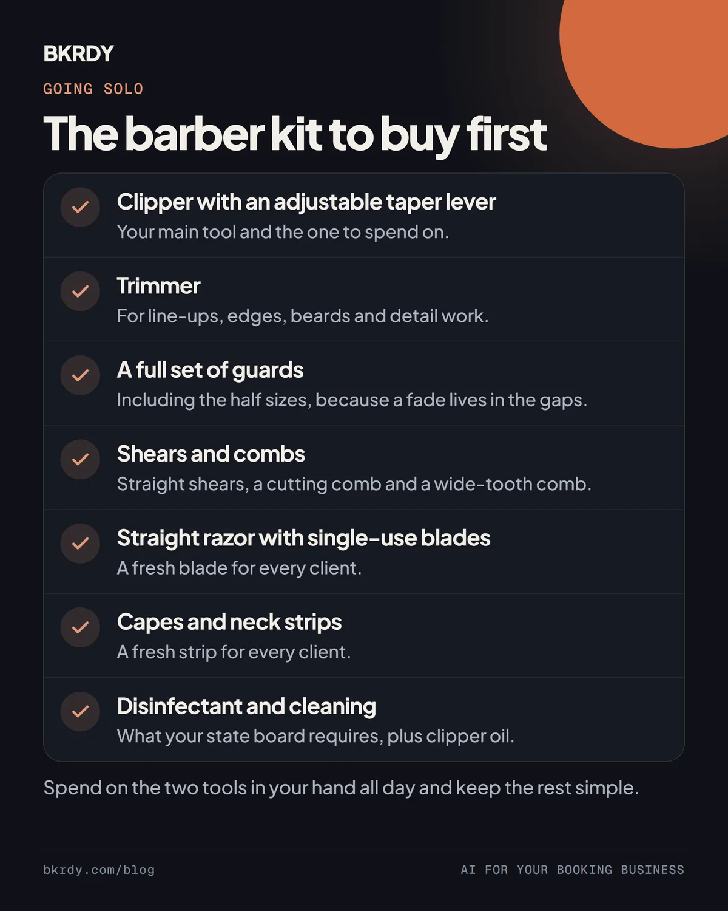

Most beginner barber kits sold as a bundle have the same problem: they give you ten tools of middling quality when you need four good ones. The tools you use on every cut are worth buying well. Everything else can wait until clients are paying for it.

Buy in the order you will use them.

:::answer
Start with one good adjustable clipper, a trimmer for lines and edges, a full set of guards, shears and a few combs, and a straight razor that takes single-use blades. Add capes, neck strips, a neck duster and the disinfectant your state board requires. A foil shaver, a second clipper and the extras can wait until you are booked.
:::

## The four tools you use on every cut

**A clipper with an adjustable taper lever.** This is your main tool and the one to spend on. Cordless is easier to move around the chair; corded never runs flat halfway through a fade. Many barbers end up with one of each, but one is enough to start.

**A trimmer.** For line-ups, edges, beards and detail work. It is the second most used tool in the kit.

**A full set of guards.** Most clippers come with some. Make sure you have every length you will blend through, including the half sizes, because a fade lives in the gaps between them.

**Shears and combs.** One pair of straight shears for scissor-over-comb and length on top, a cutting comb, and a wide-tooth comb. Thinning shears can come later.

## Shaving and finishing

A straight razor that takes single-use blades, often called a shavette, for clean necklines and line-ups. Use a fresh blade for every client. Add shaving cream or gel and a few soft towels.

A neck duster and a spray bottle finish the cut. Both cost little and every client notices them.

A hand mirror belongs here too. Showing the client the back and sides before they stand up is the moment they decide whether to book you again, and it is the easiest time to ask when they want to come back.

## Sanitation is part of the kit, not an extra

Your state board sets the rules for disinfecting tools, and an inspector will ask. Check your board's current requirements and buy what they name. In general that means:

- A disinfectant registered for your tools, and a container to soak combs and guards in.
- Clipper disinfectant spray and a cleaning brush for between clients.
- Clipper oil, because a dry blade runs hot and pulls.
- Capes and neck strips, with a fresh strip for every client.

Clean tools are also the first thing a new client looks at. A clean station says more about your work than anything on the wall.

## What can wait

- **A foil shaver.** Useful for bald fades and skin finishes, but you can learn the fade without one.
- **A second clipper.** Handy for keeping one set up for fades, but buy it when you are busy enough to need it.
- **Premium detailers, specialty blades and themed bundles.** Buy them when you know which cuts your clients ask for.
- **A full product wall.** One pomade or paste you like is enough to finish a cut and answer "what did you put in it?"

## How to spend wisely

Put the money into the clipper and the trimmer, and buy mid-range for the rest. Read the warranty, and check that replacement blades are easy to find for the clippers you choose. A cheap clipper with no spare blades becomes a replacement clipper.

Keep receipts for everything. Your tools are part of what your services cost you, which matters when you set your prices.

:::copy Barber kit checklist
Clipper with adjustable taper lever
Trimmer for lines and edges
Full set of guards, including half sizes
Straight shears, cutting comb, wide-tooth comb
Straight razor with single-use blades
Shaving cream or gel, soft towels
Neck duster, spray bottle
Capes and neck strips
Disinfectant your state board requires, soaking container
Clipper disinfectant spray, cleaning brush, clipper oil
:::

## The trade-off

Buying the cheapest full kit feels sensible when money is tight, and it can cost you twice: a clipper that pulls hair, overheats or dies mid-fade has to be replaced, and a client who feels it pulling may not come back.

Buying the most expensive version of everything is the opposite mistake. The barber matters more than the badge on the clipper. Spend on the two tools in your hand all day and keep the rest simple.

## Do this week

Check your state board's sanitation rules and list what they require. Then price one clipper and one trimmer you would be happy to use every day, and buy those first.

## Questions

### What should be in a barber kit for beginners?

A clipper with an adjustable taper lever, a trimmer, a full set of guards, shears and combs, a straight razor with single-use blades, capes and neck strips, a neck duster, and the disinfectant your state board requires.

### Is a barber starter kit bundle worth it?

Sometimes, but bundles often pad the box with tools you will not use. Compare the clipper and trimmer in the bundle with what you would buy on their own, because those two matter most.

### Do I need a foil shaver as a beginner barber?

No. It helps with skin fades and bald finishes, but you can learn to fade without one and buy it once you are busy.
