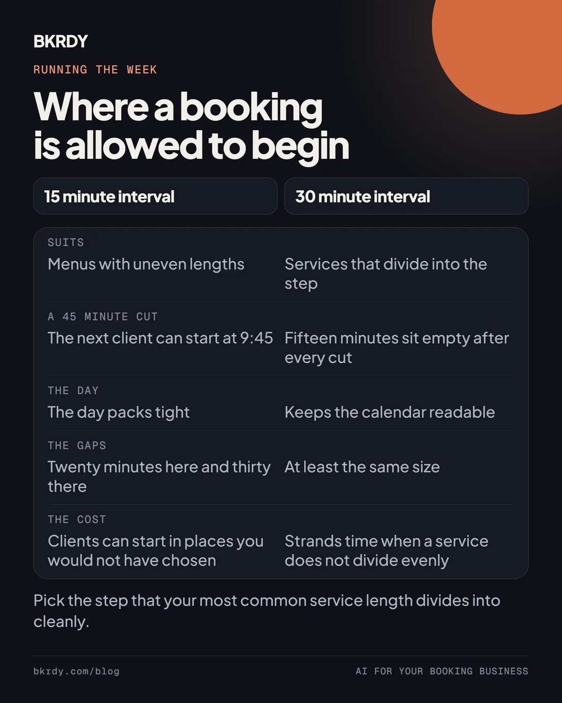

The start times your booking page offers shape your day more than your opening hours do. Open nine to six with start times every fifteen minutes and you get a different week from nine to six with start times on the hour, even with the same clients and the same services.

Most owners set this once, when they first set up their booking, and never look at it again. It is worth ten minutes, because it decides where the gaps in your day land.

:::answer
Short steps, every 15 minutes, fill odd gaps and suit a menu of uneven service lengths, but they can scatter the day into pieces nobody can use. Long steps, every 30 or 60 minutes, keep the day tidy but strand time when a service does not divide evenly into the step. Pick the step that your most common service length divides into cleanly, and set your cleanup time separately.
:::

## What the interval actually does

The interval is the spacing between the start times a client is offered. With a 30 minute interval and a 9am opening, a client sees 9:00, 9:30, 10:00 and so on. With a 15 minute interval they also see 9:15 and 9:45.

It does not change how long your services are. It changes where a booking is allowed to begin. And because every booking has to begin on one of those times, the interval decides what is left over between appointments.

A worked example. Say your most booked service is a 45 minute cut, and your first client takes 9:00.

- **On a 15 minute interval**, the next client can start at 9:45. The day packs tight.
- **On a 30 minute interval**, the next start after 9:45 is 10:00. Fifteen minutes sit empty after every cut unless someone books something that short.
- **On a 60 minute interval**, the result is the same for a 45 minute cut: every one leaves fifteen minutes behind.

Over a day of eight cuts on the 30 minute step, that is two hours in fifteen minute pieces. Some days that is breathing room. Some days it is a client you could have seen.

## Short steps: full days, scattered gaps

A 15 minute interval lets a booking start right where the last one ends, which is why it suits menus with uneven lengths: a 45 minute fill, a 75 minute set, a 20 minute brow tidy. Nothing has to round up.

The cost is that clients can also start in places you would not have chosen. A 10:15 booking in an otherwise empty morning leaves 9:00 to 10:15 as a block that fits one short service at most. Over a week, short steps can turn a day into a row of fragments, twenty minutes here and thirty there, none long enough for your main service.

Short steps work best when the day fills from one end, and worst when bookings land at random.

## Long steps: tidy days, stranded time

Thirty and sixty minute steps keep the calendar readable. Appointments start on the hour or the half hour, clients remember them, and whatever gaps are left are at least the same size.

They work when your services divide into the step. A barber doing 30 minute cuts on a 30 minute interval wastes nothing. A massage therapist doing 60 and 90 minute sessions on a 30 minute interval loses nothing either.

The cost shows up with odd lengths. A 45 minute service on a 30 minute step strands fifteen minutes after every appointment. A 50 minute massage on a 60 minute step strands ten. You can call that buffer, but it is buffer you did not choose, in the wrong place for some services and missing for others.

## How to pick for your menu

1. **List your services by how often they are booked**, not by how many you offer.
2. **Find the length most of your week is made of.** That is the number the interval has to suit.
3. **Pick the longest step that divides it cleanly.** 30 minute services, a 30 minute step. 45 minute services, 15 minutes. 60 and 90 minute sessions, 30 minutes.
4. **Set your cleanup as time between appointments**, rather than letting the interval create it by accident. [Buffer time between appointments](/blog/buffer-time-between-appointments/) covers how much to leave.
5. **Run it for two weeks, then look at the gaps.** If the same odd-sized hole appears every day, the step is wrong for your menu.

One check worth doing: if a 45 minute service really takes 45 minutes plus 15 to reset the station, then a 60 minute step may be exactly right, and the stranded time was always your reset. Count the whole thing before you change anything.

## The two numbers should be separate

The settings that matter are the start-time interval and the time between appointments, and they work best as two separate numbers. Some booking systems tie the interval to the service length, and some offer only a few fixed choices.

In BKRDY you set the start-time interval for the times clients are offered, in any step from 5 minutes up, and the time between appointments on its own. That lets a 45 minute service sit on a 15 minute step with a 10 minute reset, instead of rounding everything to the half hour.

The honest limit: no interval fixes a menu where every service is a different length and bookings arrive at random. At some point the fix is fewer service lengths, not a cleverer step. Trimming a menu from nine durations to four often does more for the day than any setting.

## What to do this week

Open last week's calendar and mark every gap shorter than your shortest service. Count them. If there are more than one or two a day, change one thing: either the interval or the time between appointments. Not both at once, or you will not know which one helped.

## Questions

### What is a booking time slot interval?

It is the spacing between the start times your booking page offers. A 30 minute interval offers 9:00, 9:30 and 10:00. A 15 minute interval also offers 9:15 and 9:45. It decides where an appointment may begin, not how long it lasts.

### Should I use 15 or 30 minute appointment slots?

Use 30 minutes if most of your services are 30, 60 or 90 minutes long, because the day stays tidy and nothing is stranded. Use 15 minutes if your common services are 45 or 75 minutes, because a 30 minute step would leave fifteen empty minutes after each one.

### Is the interval the same as buffer time?

No. The interval is where bookings may start. Buffer time, or time between appointments, is the gap you keep after each one for cleanup. Set them separately so the buffer is the size you want rather than whatever the interval leaves behind.
