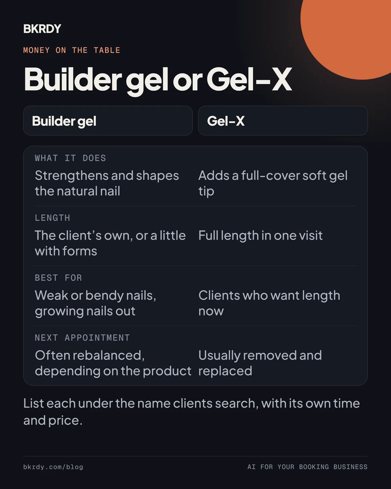

A client books "Gel-X" and arrives wanting a short, strong overlay on their own nails. Another books a builder gel manicure and arrives with a photo of long almond extensions. Both happen because clients use these names loosely, and both cost you the time you did not book.

The fix is knowing exactly what each name means, and listing them so a client can tell them apart before they book.

:::answer
Builder gel is a thicker gel built over the natural nail to strengthen and shape it, best for short to medium nails. Gel-X is one brand of soft gel tips that cover the whole nail and add length in one appointment. BIAB is one brand's name for builder gel. List each under the name clients search, say what the result is, and give each its own time and price.
:::

## What builder gel is

Builder gel is a thicker, self-leveling gel applied over the natural nail. It adds strength and a smooth shape, so it suits clients whose own nails bend, peel or break, and clients who want to grow their nails out with something protecting them.

It can be used with nail forms to add some length, but its everyday job is an overlay: the client's own nail, made stronger. At the next appointment many techs rebalance it rather than removing it completely, which depends on the product you use and the state of the nail.

## What Gel-X is

Gel-X is a brand of soft gel tips from Aprés. Each tip covers the whole nail and is attached with a gel adhesive cured under a lamp, so the client leaves with full length and shape in one visit. Other brands now sell similar soft gel tips, and many clients call all of them Gel-X.

It suits clients who want length now, without growing their own nails out. Soft gel tips are usually removed and replaced rather than filled, though techs differ, so follow your product's instructions.

## Where BIAB fits

BIAB stands for "builder in a bottle", a brand of builder gel from The GelBottle. The name caught on, and many clients now say BIAB to mean any builder gel manicure. If a client asks for BIAB and you use a different builder gel, tell them it is the same kind of service with a different product.

## Side by side

| | Builder gel | Gel-X |
|---|---|---|
| What it does | Strengthens and shapes the natural nail | Adds a full-cover soft gel tip |
| Length | The client's own, or a little with forms | Full length in one visit |
| Best for | Weak or bendy nails, growing nails out | Clients who want length now |
| Next appointment | Often rebalanced, depending on the product | Usually removed and replaced |

## Which one to recommend

Ask three questions before the appointment, at booking or in your intake form.

1. **Do you want more length than your own nails have?** If yes, Gel-X or another extension. If no, builder gel.
2. **What are your natural nails like?** Weak, peeling or bendy nails do well under builder gel.
3. **How often will you come back?** Both need regular appointments. A client who comes rarely is better off with a service that grows out gracefully.

When a client books one and clearly wants the other, say so kindly before you start, and rebook them into the right length of appointment if you need to.

## How to list them on your menu

Put them on your menu as separate services, each under the name clients search for. Add your brand in brackets if you like, but lead with the words a client would type: "Builder gel manicure" and "Gel-X full set".

Say what the result is in plain words, how long the appointment takes, and whether removal is included. Removal of someone else's product often takes extra time, so many techs list it as its own service or add-on.

:::copy Menu descriptions for builder gel and Gel-X
Builder gel manicure. A strengthening gel over your own nails for a smooth, natural shape. Best for short to medium nails that bend or break. About [time]. Removal of other products is extra.

Gel-X full set. Soft gel tips over the whole nail for full length and shape in one visit. Your choice of shape and length. About [time]. Includes removal of your previous Gel-X set from me.
:::

Time both from your own appointments, not from anyone else's. On BKRDY each service has its own length and price, and removal can be an add-on that adds its own time, so the slot a client books is the slot they need.

## How to price them

Work each one out from your own numbers: the product for one set, the time it takes you, and what you need to earn per hour. A full set of tips and a builder gel overlay take different time and product, so they should not have the same price just because both are "gel". The sum in [how to price nails as a beginner](/blog/how-to-price-nails-as-a-beginner/) works for both, and the [nail tech price list guide](/guides/nail-tech-price-list/) shows how to lay them out.

## The trade-off

Offering both means two product systems to buy, learn and keep in stock, and more ways for a booking to go wrong. If you are newer, learn one well before adding the other; the [nail tech supply list](/blog/nail-tech-supply-list/) makes the same case for buying one system first.

Offering both does let you say yes to more clients, and steer each one to the service that suits their nails. Once both are on your menu, that conversation is part of the job.

## Do this week

Read your last month of bookings for these two services and count how many clients booked one and wanted the other. Then rewrite both menu descriptions so the difference is clear before anyone books.

## Questions

### What is the difference between builder gel and Gel-X?

Builder gel is a thick gel built over the natural nail to strengthen and shape it. Gel-X is a brand of soft gel tips that cover the whole nail and add length in one appointment.

### Is BIAB the same as builder gel?

BIAB is The GelBottle's brand name for its builder gel, short for "builder in a bottle". Many clients use it to mean any builder gel manicure.

### Is builder gel or Gel-X better for weak nails?

Builder gel is usually the better fit, because it strengthens the client's own nails and lets them grow out under protection. Gel-X suits clients who want length now.
