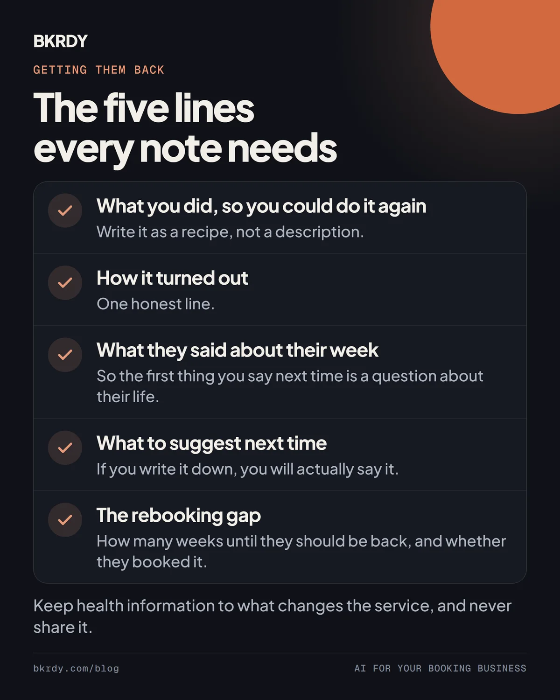

A good client note is written for one reader: you, in six weeks, with the client already in the chair and two minutes before you start. Everything in it should help that person. Anything that does not is clutter that makes the useful line harder to find.

Most notes fail in one of two ways. They are blank, because the end of the day came and the note did not happen. Or they are a paragraph about everything, and the one line you need (the formula, the curl, the shape) is buried in the middle of it.

:::answer
After every visit, write down what you did in a form you could repeat exactly (the formula, the mapping, the shade), how it turned out, anything the client told you about their week that you will want to ask about next time, what you would suggest at the next visit, and how many weeks until they should come back. Keep health information to what changes the service, and never share it with anyone.
:::

## The five lines every note needs

Write them in the same order every time. A note you can scan in ten seconds is one you will actually read before the next appointment.

1. **What you did, so you could do it again.** The formula for a colorist, with the developer and the processing time. The mapping for a lash artist: curl, diameter, the lengths from inner to outer corner. For brows, the shape, the tint shade and how long it sat. Write it as a recipe, not a description. "Warm brown" cannot be repeated. A shade and a time can.
2. **How it turned out.** One honest line. "Lifted a little warm at the ends." "Retention good, outer corners shed early." "Loved it, wants it a touch darker next time." This is the line that makes the next visit better rather than the same.
3. **What they said about their week.** The new job, the wedding in April, the dog that was sick. Not to file away as data, but so that the first thing you say next time is a question about their life rather than about the weather.
4. **What to suggest next time.** A gloss between colors, a lift instead of extensions for the summer, a shorter gap because they are growing out a line. If you write it down, you will actually say it.
5. **The rebooking gap.** How many weeks until they should be back, and whether they booked it. "4 weeks, booked." "6 weeks, said she will text." That last one tells you who to message if the date passes.

## Write it as a recipe, not a diary

The test for a note is whether someone else could read it and do the same service. You will not hand it to someone else, usually, but writing to that standard keeps out the vague words.

Compare two notes for the same color appointment:

> "Did her usual, looked great, she was happy."

> "6N + 7G, 20 vol, 35 min at roots. Ends glossed 8V, 10 min. Slightly warm at ends, she liked it. Suggest a gloss at 4 weeks. 8 weeks, booked."

The first is a feeling. The second is a service you can repeat on a day you are tired and running late, which is exactly the day you will need it.

For lash and brow work, a photo does what words cannot. A picture of the finished set or the shape at the end of the appointment settles any "it was fuller last time" conversation before it starts, and it shows you how the work grew out when they come back.

## Health information: only what changes the service

Some things a client tells you do belong in the note, because they change what you do. A reaction to an adhesive. Sensitive skin that cannot take a certain product. Something that means you should not wax, tint or lift until it has passed.

Write those as plainly and briefly as you can, and write the consequence rather than the detail. "Reacted to standard adhesive in May, use sensitive." "No brow wax until cleared, use threading." You do not need to know why, and you should not ask more than the service requires.

Everything else they tell you about their health stays out of the note. And none of it, ever, goes anywhere else: not to another client, not to your group chat, not to a coworker who did not need it. A client who tells you something private in the chair is trusting you with it.

## Where to keep them

Anywhere you will actually open before the next appointment. A paper card system works if it lives at your station. A notes app works if you name every note the same way. The failure is notes spread across three places, so that the one you need is always in the other one.

Most booking software has a notes field on the client record. In BKRDY, a client's profile holds notes, preferences and their visit history, and once a visit has happened you can upload a photo of the finished work from the appointment, which then shows on their profile as the last service. The [client records](/platform/) are the same place you look when they book again, which is what makes the note get read.

If you track a lot of detail for one trade, nail techs especially, there is a longer walkthrough on [client preference tracking](/blog/client-preference-tracking-for-nail-services-2026-guide/).

## The template

Copy this into wherever your notes live, and fill it in before the next client sits down, not at the end of the day.

:::copy Client note template
Date and service:
What I did (formula, mapping, shade, timing):
How it turned out:
What they told me (to ask about next time):
Suggest next time:
Rebook in: [ ] weeks. Booked: yes / no
Service notes (anything that changes what I do):
:::

## The honest trade-off

Notes take time, and the time comes at the worst moment: between clients, or at the end of a long day when you want to go home. Two minutes a client is not much, but across a full day it is a real stretch of work you are not paid for directly.

The cost of skipping them shows up slowly. You repeat a formula from memory and it comes out a shade off. A client mentions her daughter's graduation and you have forgotten she had a daughter. Neither will lose you the client on its own. Enough of them together is how a regular starts to feel like a number, and drifts.

So write less, not nothing. If two minutes is too long, write the recipe line and the rebooking gap and leave the rest. Those two lines do most of the work.

## Do this week

1. Paste the template into your notes field or onto a card.
2. For the next five clients, fill it in before the next one sits down.
3. Before each appointment next week, read the client's last note first, and open with something from the "what they told me" line.

If they did not book before they left, the note's last line tells you who to follow up with. The [rebooking guide](/guides/how-to-rebook-clients/) covers what to say.

## Questions

### What should I write in client notes?

What you did in a form you could repeat (formula, mapping, shade, timing), how it turned out, anything they told you about their week, what to suggest next time, and how many weeks until they should come back.

### Should I write down a client's health information?

Only what changes the service, such as a reaction to a product, and only the consequence: what you will do differently. Leave everything else out of the note, and never share any of it.
