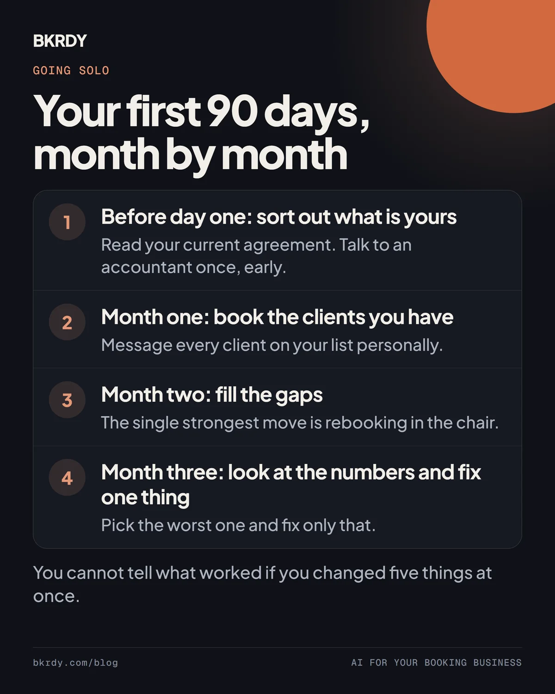

The first ninety days after you leave a salon or a booth are not about growth. They are about keeping the clients who followed you, and getting the basics to run without you thinking about them. Growth is a problem for month four.

Most stylists leave with a list of people who said they would follow. Some will, some will not, and the ones who do will judge the new setup on their first visit. Ninety days is roughly long enough to see your regulars come back through once, which is why it is a useful length to plan in.

:::answer
Spend month one booking the clients you already have and making the basics work: a booking page, a price list, a cancellation policy, a way to take payment. Spend month two filling the gaps, mostly by rebooking every client before they leave the chair. In month three, look at your own numbers and fix one thing, not five.
:::

## Before day one: sort out what is yours

Two things to do before you open, both quick. First, read your current agreement, if you have one, for anything about clients, notice or where you can work next. What it means is a question for the agreement itself, not for a blog. Second, talk to an accountant once, early, about how to set up the money side. Being paid by your own clients is a different arrangement from a paycheck, and it is easier to set up right at the start than to untangle later.

Then write down every client you can reach, with how they like to hear from you. That list is the business. Everything else is equipment.

## Month one: book the clients you have

Your first month is not for strangers. It is for the people who already trust your hands.

- **Message every client on your list personally.** One at a time, by name, with your new booking link. A group post reaches fewer people than you think.
- **Make booking the easy part.** One link, real prices, real durations, open times they can pick without messaging you. Every booking that takes three texts is one somebody gives up on.
- **Put your policies in writing from the first booking.** Cancellation window, deposit if you take one, lateness. Starting with a policy is far easier than introducing one to clients who got used to none.
- **Decide how you get paid** before anyone sits down. A card, a payment link or cash, said plainly.

If you came from a booth, you already did much of this. If you came from commission, this is the month the front desk becomes your job. The [booth rent vs commission](/blog/booth-rent-vs-commission/) break-even is worth rereading now, with real numbers in place of hopes.

## Month two: fill the gaps

By week five you will see the shape of your week. Some days fill, some have holes in the middle. Month two is about the holes.

The single strongest move is rebooking in the chair. Before a client stands up, ask when they want their next appointment and book it while they are still there. It costs nothing, takes thirty seconds, and is the difference between a client who comes every five weeks and one who comes when they remember. If it is not a habit yet, [how to rebook clients](/guides/how-to-rebook-clients/) walks through the wording.

Then the gaps that are left:

- **Look at which hours never fill.** If Tuesday mornings stay empty for four weeks, stop opening them and move those hours to a time people want.
- **Ask your regulars for one name.** Not a referral program, just a question: who else do you know who would like this?
- **Keep a short list of people who want to come in sooner.** When someone cancels, you have somebody to call instead of an empty hour.

## Month three: look at the numbers and fix one thing

At ninety days you have enough of a record to read. Sit down for an hour with four numbers:

1. How many clients came back for a second visit.
2. How many appointments were cancelled late or missed.
3. Which days ran full and which ran half empty.
4. What you actually kept after rent, supplies and fees, per hour you were at work.

Then pick the worst one and fix only that. If late cancellations are the problem, tighten the window or start taking a deposit. If second visits are the problem, it is almost always rebooking. If the hourly figure is low, it is probably price, and that is a harder conversation for month four.

Fixing one thing is not modesty. You cannot tell what worked if you changed five things at once.

## What the first ninety days cost you

The honest trade-off: going independent means more money per client and more work per client. The messages, the reminders, the payment, the restocking, the cleaning, the evening spent on a price list. A lot of that was invisible at the salon because someone else did it.

Not everyone wants that job, and wanting to leave a bad salon is a different thing from wanting to run a business. If month two shows you hate the admin more than you hated the old setup, a better salon may be the right move. That is a real answer, not a failure.

## Get the basics running before you need them

The setup in month one should be boring and quick. A booking page with your services, a calendar with your hours, a reminder that goes out without you, a cancellation policy clients see when they book.

BKRDY's Free plan gives you a booking page at yourname.bkrdy.me with a calendar and an email reminder for every appointment, with no card needed, which is enough to run month one. Whatever you use, set it up once, in the first week, and stop thinking about it.

:::copy The first message to a client after you go independent
Hi Renee, I have moved to my own space and I would love to keep doing your hair.

Same me, same prices for now, and booking is easier: you can pick a time here whenever suits you. [your booking link]

If you would rather I book you in, reply with a week that works and I will sort it.
:::

## Questions

### How long does it take to build a full book after going independent?

There is no honest single number. It depends on how many clients followed you and how often they come. Ninety days is a useful first checkpoint because most regulars will have come through once by then, so you can see who stayed.

### What should I set up before my first independent client?

A booking page with prices and durations, a written cancellation policy, a way to take payment, and a list of every client you can contact. Read your current agreement before you message anyone on that list.

### What is the most important habit in the first three months?

Rebooking in the chair. Asking every client for their next appointment before they leave fills your calendar from the people who already like your work, which is cheaper and steadier than finding new ones.
