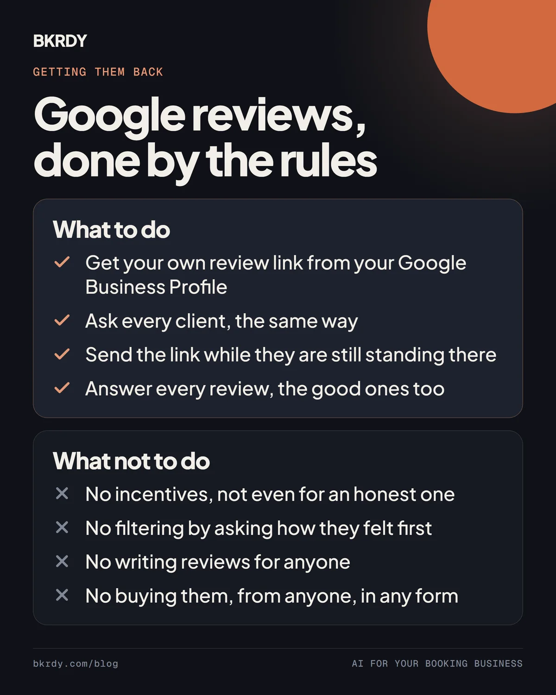

Google reviews are the ones a stranger sees first. Someone searches for a colorist near them, your salon comes up on the map, and the stars and the three most recent reviews sit right beside your name. That is the decision, often made before anyone opens your website.

Getting more of them is not complicated. It is a short link, one sentence you say the same way to every client, and a reply to every review that comes in. The rules around it are strict, though, and the shortcuts that break them are exactly the ones that look tempting when your count is low.

:::answer
Get your own review link from your Google Business Profile, ask every client for a review in the same words, and answer every review you get. Never offer anything in return, never ask only the clients you think are happy, and never ask how they felt first and send the link only to the ones who said great. Those are Google's rules, and breaking them can cost you the reviews you already have.
:::

## Get your own review link

You need a direct link that opens the review box for your salon, so the client never has to search for you.

1. Sign in to the Google account that manages your Business Profile.
2. Open your profile, either by searching your salon's name on Google while signed in or from Google's Business Profile manager.
3. Look for the option to ask for reviews. Google's menus move around, so it may be a button on the profile panel or under a reviews section. It gives you a short link to share.
4. Copy the link, open it on your own phone, and check it lands on your salon and not a different branch or a similarly named business.

Save the link somewhere you can paste it in two taps: a note on your phone, a text shortcut, or a pinned message to yourself. The ask fails when the link takes a minute to find.

## Ask every client, the same way

The rule that matters most is the one people break without meaning to: you ask everyone, not only the clients who seemed thrilled. Asking only the happy ones is selective solicitation, and Google treats it as against its policy even if every review it produces is genuine.

The simplest way to stay inside it is to make the ask part of checkout for every client, in the same words, every time. Say it, then send the link while they are still standing there.

:::copy What to say at checkout
If you have a minute later, a Google review really helps people find me. I will text you the link now so you do not have to look for it.
:::

:::copy The text with the link
Hi [First name], thanks for coming in today. Here is that link if you have a minute: [your Google review link]
:::

One ask and, if you like, one gentle reminder a few days later. Then stop. For more wording, including email and a version for a long-time regular, there are ready-made [templates to ask for reviews](/guides/ask-for-reviews-templates/).

## What not to do, even when it is tempting

These are the moves that look harmless and break Google's rules.

- **No incentives.** No discount, no free add-on, no entry into a draw for a review. Not even for an honest one.
- **No filtering.** Do not send a "how did we do?" message first and only pass the Google link to the people who answered well. That is gating, and it is the same as asking only the happy ones.
- **No writing reviews for anyone.** Not for a client who says "just write something for me", not on their phone, and never yourself or your staff reviewing your own salon.
- **No buying them.** From anyone, in any form.

The risk is real and lopsided. A few extra stars are not worth reviews being removed or a warning on your profile, and a salon with a modest number of honest reviews reads better to a stranger than one with a suspicious pile of perfect ones.

## Answer every review

Reply to every review, the good ones too. A short, specific thank you on a five star review shows a stranger that a person reads them. "Thank you, Dana, that copper came out exactly how we planned it" is better than "Thanks for the review!" pasted under every one.

Keep anything private out of a reply. Do not confirm details the client did not mention, and never mention anything about their health, their history with you or what they paid.

For a bad review, wait before you type, keep it short and calm, and move the conversation somewhere private. The full approach is in [how to respond to a negative review](/guides/responding-to-negative-reviews/). Do not ask Google to remove a review because it is negative; that is not a reason it will accept.

## The honest trade-off: this stays a job you do by hand

Asking for Google reviews takes a habit, and the habit falls apart on busy days, which is when you have the most happy clients to ask. Some weeks you will forget. That is normal, and the fix is to make the ask part of checkout rather than something you try to remember.

If you use booking software that sends review requests, check where those reviews go. BKRDY's review requests (on paid plans) go by email and publish four and five star reviews on your own BKRDY site, with one to three stars kept private for you to read. Nothing is sent to Google. That is useful for your own booking page, but it means your Google reviews remain a separate job you do by hand, in the way this article describes.

So the two can run side by side: the reviews on your own site come from the software, and the Google ones come from you, at the counter.

## Do this week

1. Get your review link, open it on your phone and save it where you can paste it in two taps.
2. Choose your checkout sentence and use it on every client this week, without deciding who deserves it.
3. Reply to the three most recent reviews you have not answered.

## Questions

### How do I get a link for clients to leave a Google review?

Sign in to the Google account that manages your Business Profile, open the profile, and look for the option to ask for reviews. It gives you a short link that opens the review box for your salon. Test it on your own phone before you share it.

### Can I offer a discount for a Google review?

No. Google does not allow incentives for reviews of any kind, including a discount, a free add-on or a prize draw, even when the review is honest.

### Can I ask only my happy clients for a Google review?

No. Asking only the clients you expect to be positive, or asking how they felt first and sending the link only to the ones who answered well, is against Google's rules. Ask every client the same way.

### Should I reply to every Google review?

Yes, positive and negative. A short, specific thank you on a good review shows a person reads them, and a calm reply to a bad one is read by every future client who sees it.
