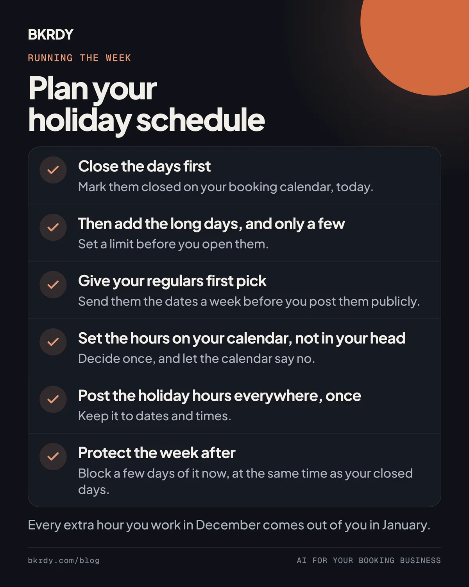

Plan your holiday schedule in November, and in a fixed order: the days you will close, then the extra hours you will add, then who gets to book them first. Do it the other way round and December decides for you. The extra Saturday fills before you notice you had promised it to your family.

Every December has the same shape. Demand arrives at once, in the two weeks before the 25th, and most of it comes from your regulars, the people who visit every few weeks and want their appointment pulled closer to a party. Then the week after the holiday goes quiet, and January starts slow.

:::answer
Decide your closed days first and put them on your calendar before anyone can book them. Then choose the few long days you will add, offer those dates to your regulars by message before anyone else, and post one holiday hours note everywhere a client might look. Protect the week after, because December hours are paid for with January energy.
:::

## Close the days first

Start with what you will not work. Christmas Eve afternoon, the 25th, the 26th if you travel, New Year's Day, the school days off you already know about. Write them down before you think about money.

Closed days go first because they are the ones that get eaten. Once an extra Saturday is open, someone books it, and a booked day is far harder to take back than an unopened one.

Then mark them closed on your booking calendar, today. A day you have decided to close but not closed in the system is still open to anyone who looks.

## Then add the long days, and only a few

Now choose where the extra hours go. Look at last December if you kept it: which days filled first, which time of day ran out. For a lot of books that is the Saturday and the two weekday evenings closest to the 25th.

Add hours to specific dates rather than changing your whole week. An earlier start on the 19th and a later finish on the 22nd fit around an ordinary schedule. A blanket change to every December day turns into a month you cannot get out of.

Set a limit before you open them. Say you normally take six clients on a Saturday. Decide now whether the holiday Saturday is seven or eight, not on the morning itself, when someone asks nicely.

## Give your regulars first pick

The clients who come every three or four weeks are the ones December is really for. They will rebook anyway, and they are the ones who remember who fit them in.

Send them the dates a week before you post them publicly. A direct message, not a story. Your regulars should not have to compete with a stranger who happened to scroll past at the right moment.

The simplest version is to book them at the chair in November. Whoever sits in front of you this month gets one question: do you want your December appointment now?

:::copy Holiday hours message for your regulars
Hi Tasha, my December dates are open to regulars first this week, before I post them anywhere.

Extra hours: Saturday the 19th from 8am, and Tuesday the 22nd until 8pm. I am closed from 2pm on the 24th, all of the 25th and 26th, and back on the 29th.

Want me to hold one for you? Reply with a day and a rough time and I will book it in.
:::

## Set the hours on your calendar, not in your head

Whatever booking system you use, the plan only holds if the calendar enforces it. Check each of these:

- The closed days are marked closed, so nobody can book them.
- The long days have their own hours for that date only, so your usual week stays as it is.
- The busy days have a limit on how many clients they hold, if your system has one.
- Your booking window reaches far enough to show the December dates, but not so far that people book February while they are at it.

In BKRDY you can mark days off, give a single date its own hours and breaks, and set a daily limit for the whole studio, so a long Saturday opens without changing every Saturday. A paper diary does the same job if you are strict with it. The rule is the same either way: decide once, and let the calendar say no.

## Post the holiday hours everywhere, once

Clients look in different places. Some check your booking page, some your bio, some just text you. Write one short note and put the same words everywhere: your booking page, your bio, a pinned post, the sign on your door if you have one.

Keep it to dates and times. No apology for being closed, no explanation of why. A client checking whether you are open on the 24th wants one line, not a paragraph.

Take it down in the first week of January. A holiday note still up in February makes a business look abandoned.

## Protect the week after

This is the trade-off nobody plans for. Every extra hour you work in December comes out of you in January: your hands, your back, your patience with the fourth client of a long evening.

And January is quiet anyway. The clients who came in on the 22nd will not be back until late January at the earliest. So the week after the holiday is the cheapest week of the year to rest, and the worst week to discover you are exhausted.

Block a few days of it now, at the same time as your closed days. If you cannot take the whole week, take the two days after your longest stretch. A holiday schedule that leaves you unable to work in January did not earn you anything.

The honest version for a thinner book: extra December hours are a gamble, not a plan. Open one long day, see whether it fills, and add a second only if it does.

## What to do this week

1. Write down your closed days and mark them on the calendar.
2. Pick at most three dates for extra hours, with a client limit on each.
3. Message your regulars with the dates before anything goes public.
4. Block at least two days of rest in the first week of January.

## Questions

### When should a salon post its holiday hours?

Early in November for your regulars, by direct message, and about a week later publicly. Clients plan December appointments around parties and travel before the month starts, and the dates you share first are the ones they plan around.

### Should I work extra hours in December?

Only on a few chosen days, with a limit decided in advance, and only if you will still be able to work properly in January. If your book is thin, open one long day first and add more only if it fills.

### Do I have to explain why I am closed?

No. Dates and times are enough. A short note that says when you are open and when you are closed answers the question a client actually has.
