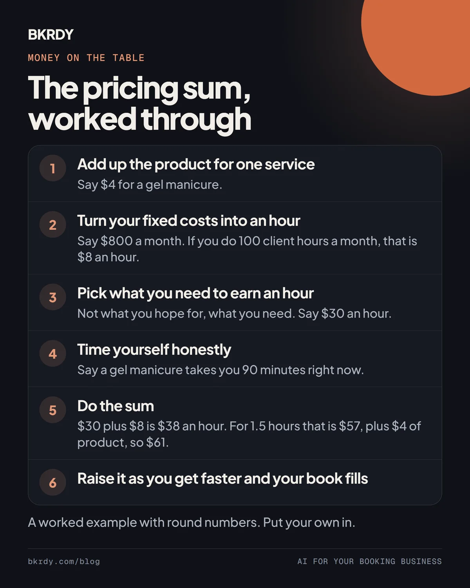

A common way to set a first price is to look at the cheapest salon nearby and go a little under it. It feels safe. It can be the most expensive decision of your first year, because that salon is faster, buys product in bulk, and may be pricing to fill chairs rather than to pay anyone well.

Your price should come from your own costs and your own time. The number you get may be higher or lower than the place down the road. Either way, you will know what each set actually pays you.

:::answer
As a beginner, price each nail service from four things: the product it uses, your fixed costs turned into an hourly figure, what you need to earn an hour, and how long the service really takes you today. Price nail art by the extra time it adds, per nail or in tiers, and give removal its own line unless the client is rebooking with you. Raise prices as you get faster and your book fills.
:::

## The pricing sum, worked through

Here is a worked example with round numbers. Put your own in.

1. **Add up the product for one service.** Gel, base and top coat, tips, files, wipes, the cotton. Say $4 for a gel manicure.
2. **Turn your fixed costs into an hour.** Rent or a room share, insurance, booking software, laundry, the lamp you will replace. Say $800 a month. If you do 100 client hours a month, that is $8 an hour.
3. **Pick what you need to earn an hour.** Not what you hope for, what you need. Say $30 an hour.
4. **Time yourself honestly.** From greeting the client to wiping down the table. Say a gel manicure takes you 90 minutes right now.
5. **Do the sum.** $30 plus $8 is $38 an hour. For 1.5 hours that is $57, plus $4 of product, so $61. Call it $60.
6. **Raise it as you get faster and your book fills.** More on that below.

Now look at the cheapest salon nearby at $35. At your current speed, $35 minus $4 of product is $31 for 90 minutes, about $20.67 an hour, and after your $8 of fixed costs you are earning under $13 an hour. That is the number you would have been working for without knowing it.

## When your number is higher than your area will pay

It might be. A beginner who takes 90 minutes may not be able to charge $60 for a gel manicure yet, especially without a portfolio.

You have three honest options, and you can mix them:

- **Charge less for a while, knowingly.** Set a beginner price with a date on it, and know exactly what each set is costing you per hour.
- **Cut the time.** Practice on friends, prep faster, set up your station before the client arrives. Speed is the biggest number in the sum.
- **Cut the fixed costs.** A shared room instead of your own, one lamp instead of two, fewer colors until you know what sells.

What you should not do is go under the floor: product plus fixed costs for the time it takes. Below that, every client costs you money.

## How much to charge for nail art

Nail art takes time, so price it from the time. At $38 an hour, every 10 minutes is worth about $6.

There are two ways to put it on a menu.

**Per nail** works for accents. A single accent nail that adds 5 minutes is about $3. Two accent nails, about $6. Clients understand it, and it scales with how much they want.

**In tiers** works better for full sets, because a design across ten nails is not ten times one accent. A worked example at the same rate:

| Tier | What it covers | Extra time | Price |
|---|---|---|---|
| Simple | Dots, lines, a French tip | 10 minutes | $6 |
| Medium | Chrome, a few hand-painted accents | 20 minutes | $13 |
| Full | Hand-painted on every nail | 40 minutes | $25 |

Ask for an inspiration photo before the appointment and quote the tier then. A client who learns the price of their design at the end is a client who argues about it.

## How much to charge for nail removal

Removal is real work: soaking, filing, protecting the natural nail. Price it from the time like everything else.

**Give it its own line** when the client comes in wearing someone else's work. Another salon's acrylic can take longer than your own, and you do not know what is under it. If it takes you 30 minutes, at $38 an hour that is about $19, so $20.

**Include it when they rebook with you.** Soaking off your own gel before a new set is part of a maintenance appointment, and the time is already in your service length. It is a small reason to come back to you rather than try somewhere new. A removal on its own, with no new set after it, still carries its price.

Put both in writing, under your services:

:::copy Nail art and removal lines for your price list
Nail art: simple $6, medium $13, full $25. Accent nails $3 each.
Removal of another salon's work: $20.
Removal included when you rebook with me.
:::

The [nail tech price list](/guides/nail-tech-price-list/) has a full menu structure you can copy.

## When to raise as your speed improves

Here is what speed does to the example. If your gel manicure drops from 90 minutes to 60, the same $60 earns you $60 minus $4 minus $8, which is $48 an hour. You got a raise without changing a price.

So the price itself does not need to chase your speed. It needs to chase demand. Raise when:

- your book is full a week or two ahead, most weeks;
- you are turning people away for the same days;
- your costs have gone up since you last set prices.

At that point the extra time speed bought you is worth more as fewer, better-paid appointments than as more clients. The [daily capacity sum](/blog/how-many-clients-per-day/) helps you see when you have reached it.

## The trade-off

Pricing from your own costs will sometimes give you a number your area will not pay yet. That is not the sum being wrong. It is the sum telling you what a low price costs, so you can choose it on purpose.

And the cheapest salon is not wrong either. It may be the right place for a client who wants a quick, cheap set, and you may not want to compete for that client at all.

This week, time three of your services from greeting to wipe-down, write down what they used, and run the sum. Then look at your price list and see which line is paying you the least.

## Questions

### How much should I charge for nails as a beginner?

Work it out from your product cost, your fixed costs per hour, what you need to earn an hour, and how long the service takes you today. In the worked example, $4 of product, $8 an hour of fixed costs, $30 an hour of pay and 90 minutes comes to about $60 for a gel manicure. Your numbers will differ.

### How much should I charge for nail art?

By the extra time it adds. Work out what 10 minutes of your time is worth and price accents per nail and full designs in tiers. Quote it from an inspiration photo before the appointment, not at the end.

### Should I charge for nail removal?

Yes, when the client comes in with someone else's work, because it takes real time and you do not know what is under it. When they are rebooking with you, including it is fair, since the time is already part of the maintenance appointment.
