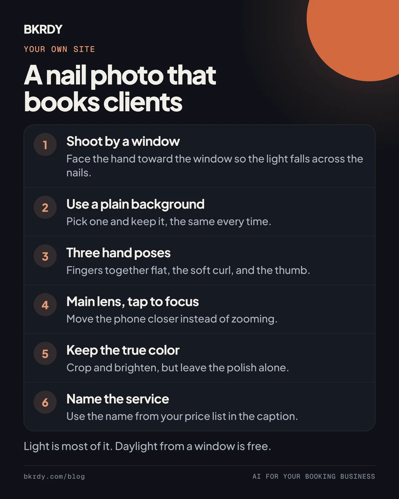

A client choosing a nail tech scrolls photos before they read a word. The set you did is only as good as the picture of it, and most nail photos that disappoint have the same three problems: yellow light, a busy background, and a hand held at an awkward angle.

All three are fixed before you take the picture, not after.

:::answer
Shoot by a window in daylight, on a plain background, with the phone's main lens rather than zoom. Use the same two or three hand poses every time, tap the nails to focus, and lower the exposure if the shine blows out. Keep the polish its true color when you edit, and name the service in the caption so people know what to book.
:::

## Light is most of it

Daylight from a window is the best light you have, and it is free. Face the hand toward the window so the light falls across the nails, not from behind them. Overcast days are even better than bright sun, which throws hard shadows.

Avoid the ceiling light of most salons. It is often yellow or green and makes a nude polish look muddy.

Ring lights are useful at night, but they leave a bright circle reflected in every glossy nail. If you use one, tilt the hand slightly until the circle slides off the nail, or move the light to the side.

## A plain background, the same every time

The nails are the subject. Anything behind them competes. A sheet of white or light grey card, a plain towel, or a smooth tabletop all work.

Pick one and keep it. When every photo on your page has the same background, the page looks like a portfolio rather than a camera roll, and the differences between sets are what people notice.

## Three hand poses to learn

You do not need a dozen poses. Three cover almost every set.

1. **Fingers together, flat.** The hand rests on the surface, fingers straight and touching. It shows shape and length clearly.
2. **The soft curl.** Fingers curved gently toward the palm, nails toward the camera. It shows the whole set at once and looks relaxed.
3. **The thumb.** The thumb is usually cut off in the first two. Take one photo of the thumb on its own, or hold the hand so the thumb sits in front.

Ask the client to relax their hand first. A tense hand shows in the knuckles. Clean any product off the skin around the nails before you shoot, because the camera finds it.

## Phone settings that matter

- **Use the main lens.** Digital zoom makes the picture soft. Move the phone closer instead.
- **Tap to focus on the nails.** Phones like to focus on the brightest thing in the frame.
- **Lower the exposure if the shine blows out.** After tapping, slide the brightness down until the top coat shows a highlight, not a white patch.
- **Wipe the lens.** A smudged lens gives everything a haze, and phones live in pockets.
- **Go easy on portrait mode.** It can blur the edges of the nails along with the background.

## Edit, but keep it honest

Straighten the photo, crop it close, and brighten it if the room was dim. Leave the polish color alone. A client who books a shade from your photo expects that shade on their own nails.

Use the same small set of edits on every photo, so your page stays consistent.

## Photograph the set again at the fill

A fresh set always looks good. A set that still looks neat two or three weeks later is what convinces a careful client, because it shows your prep and product hold up.

When a client comes back for a fill, take one photo before you start, in the same spot and pose as the first. Posted side by side, the two pictures say more about your work than another fresh set.

## Say what it is

A beautiful photo with no caption makes people message you to ask what it was. Name the service the way it appears on your price list, so they can find it and book it.

:::copy Caption for a nail post
Short gel set with chrome on the accent nails. Booked as: Gel manicure with nail art. Link in bio to book.
:::

## The trade-off

Good photos take a few minutes at the end of an appointment that is often already running late. Build the time into the booking rather than rushing it, or you will skip it on the days you are busiest, which are the sets most worth showing.

And a perfect photo of a set you rarely want to do brings you more of it. Post the work you want to be booked for.

## Do this week

Choose a spot by a window and leave a plain card there. Photograph your next five sets there, same background, same three poses, and post the best one with the service name in the caption.

## Questions

### What is the best light for nail pictures?

Daylight from a window, ideally on an overcast day, with the hand facing the window. Ceiling lights in most salons make polish look yellow or muddy.

### How do I stop my ring light showing in the nails?

Tilt the hand until the reflection slides off the nail, or move the light to one side so it lights the nails at an angle rather than straight on.

### Should I edit my nail photos?

Crop, straighten and brighten if you need to, but do not change the color of the polish. A client who books from your photo expects that exact shade.
