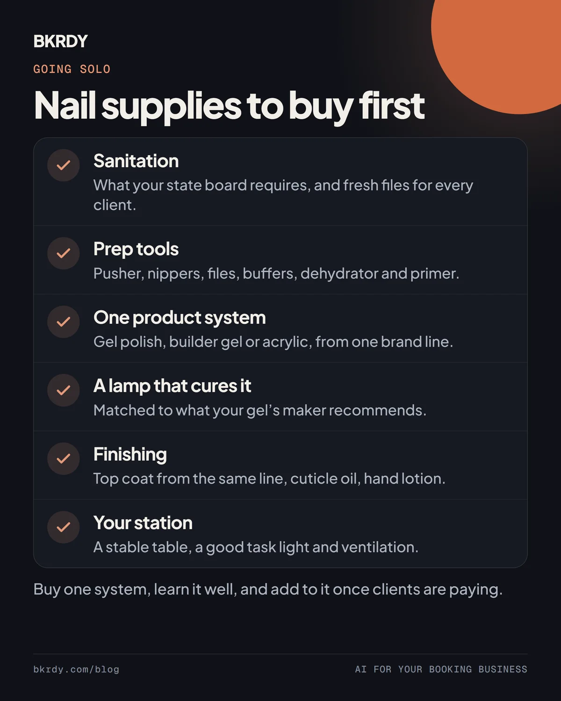

New nail techs tend to overspend on color and underspend on the things clients never see: prep tools, sanitation and a good lamp. Those are what make a set last, and they are what an inspector looks at.

Buy one system, learn it well, and add to it once clients are paying.

:::answer
Start with sanitation supplies your state board requires, then prep tools, one product system from a single brand line, the lamp that cures it, and finishing products. Add a stable table, a good task light and ventilation. Leave the wall of colors, extra systems and an electric file for later, once you know what your clients book.
:::

## Sanitation first

Your state board sets the rules for cleaning and disinfecting, and an inspector will check. Look up your board's current requirements and buy what they name. In general that means:

- A disinfectant registered for your implements, and a container to soak metal tools in.
- Single-use files and buffers, or a way to disinfect them if your board allows reuse, and a fresh set for every client.
- Gloves, paper towels, lint-free wipes and a covered bin.
- A closed container for clean implements, kept apart from used ones.

## Prep tools

Good prep is what keeps a set on. These are small costs that pay back on every client.

- A cuticle pusher and cuticle nippers.
- Files in a few grits, for shaping and for refining.
- Buffers.
- A nail dehydrator and primer suited to the system you choose.
- A nail brush to clear dust.

## One product system

Pick one: gel polish, builder gel, or acrylic. Learn it until your sets are consistent before adding a second.

Buy the system within one brand line, because base, color and top coat are made to work together. Mixing brands is a common reason sets lift early, and it makes it hard to tell what went wrong.

Start with a handful of colors clients actually ask for: a few nudes and pinks, a red, a black, a white, and one or two seasonal shades. You can add colors as clients request them.

## A lamp that cures what you use

Gel needs the right lamp to cure. Check that the lamp matches what your gel's maker recommends. A lamp that under-cures leaves product soft underneath, which leads to lifting and can irritate the skin.

## Finishing

Top coat from the same line, cuticle oil, and a lotion for the hands. A small bottle of cuticle oil to send home with clients is a nice touch and a reason for them to think of you.

## Your station

- **A stable table** at a height that keeps your back straight.
- **A good task light**, so you can see the cuticle line clearly.
- **An armrest or cushion** for the client's wrist.
- **Ventilation.** Filing creates dust and many products give off fumes. A nail dust collector or proper ventilation protects you over years of breathing it.

If you are working from home, check your local rules first. Some places need a separate licensed space. The [guide to starting a nail business at home](/blog/start-a-nail-business-at-home/) covers that side.

:::copy Nail tech supply checklist
Disinfectant your state board requires, soaking container
Single-use files and buffers, gloves, wipes, paper towels
Closed container for clean tools, covered bin
Cuticle pusher, cuticle nippers, nail brush
Files in two or three grits, buffers
Dehydrator and primer for your system
One product system from one brand line: base, colors, top coat
Lamp that matches your gel
Cuticle oil, hand lotion
Stable table, task light, armrest, ventilation or dust collector
:::

## What can wait

- **An electric file.** It speeds up removal and prep, but learn by hand first and get trained on it before using it on clients.
- **A second product system.** Add acrylic or builder gel once the first is second nature.
- **A wall of colors.** Buy shades as clients ask for them.
- **Nail art extras.** Foils, charms, chrome powders: add them when clients book art, and price the art accordingly.

## The trade-off

A cheap all-in-one beginner kit looks like good value, and it often mixes products that were not made to work together, with a lamp that does not cure them properly. You save at the start and lose it in lifting, redos and clients who do not come back.

Spending heavily on everything at once is the opposite mistake. Spend on sanitation, prep and the one system you are learning. The rest can be bought with the money those sets earn.

## Do this week

Look up your state board's sanitation rules and write down what they require. Choose your one product system and the lamp that cures it, then buy those and the prep tools before anything else.

## Questions

### What supplies do I need as a beginner nail tech?

Sanitation supplies your state board requires, prep tools, one product system from a single brand line, a lamp that cures it, finishing products, and a stable table with good light and ventilation.

### Is a nail tech kit for beginners worth buying?

Some are, but many mix products that are not made to work together and include a lamp that may not cure them properly. Compare the system and lamp in the kit with buying them on their own.

### Should I start with gel or acrylic?

Start with one, whichever your training focused on, and learn it until your sets are consistent before adding the other.
