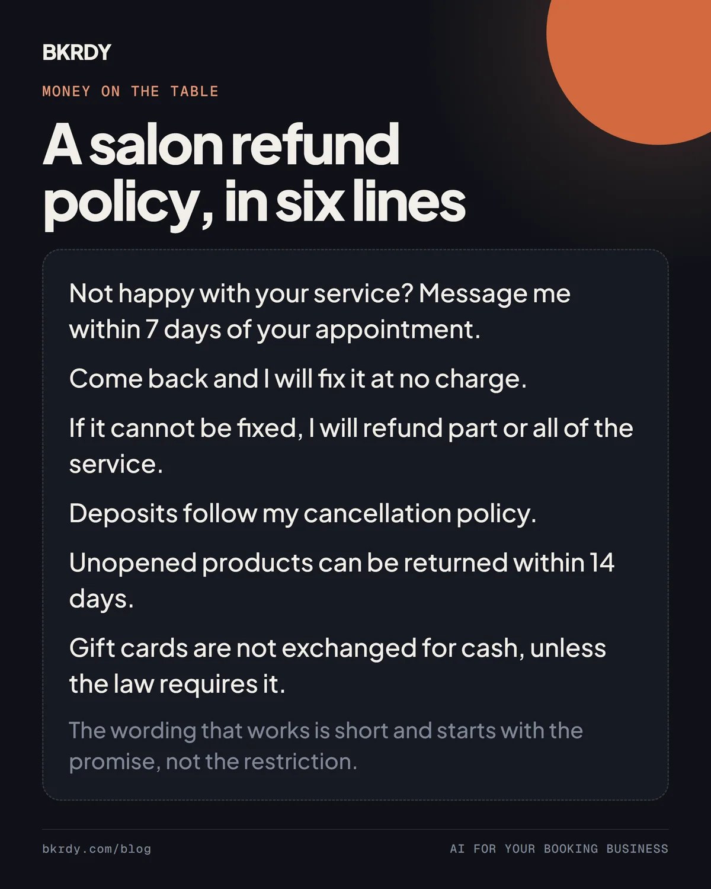

A shirt can go back to the shop. A gel set, a brow wax or a facial cannot. Once the service is done, the time and the product are spent, and there is nothing to return.

So a refund policy for a salon is really a fix-it policy. It says what you do when a client is unhappy, how long they have to tell you, and the narrow cases where money does come back. Written that way, it protects your time and still treats the client fairly.

:::answer
A salon refund policy should promise a free fix first: a redo or an adjustment if the client tells you within a set number of days. Money comes back only in named cases: deposits under your cancellation policy, unopened products, and a service that went wrong and cannot be fixed. You decide which applies after seeing the work in person, and you say all of it in plain words before anyone books.
:::

## Why a service refund becomes a promise to fix it

A client who is unhappy with a set rarely wants their $60 back. They want nails that do not lift, brows that match, color that is the color they asked for. A refund sends them away with the problem still on their hands, and they tell people about the problem, not the refund.

A redo keeps them in your chair and gives you the chance to put it right.

The policy's job is to make the fix the normal answer and the refund the exception, and to say so before anything goes wrong.

## Set a redo window, by service

The window is how long a client has to tell you, and it should match how long a problem takes to show.

- **Nails.** Lifting or a chip from your work usually shows within a few days. A week is a fair window.
- **Waxing.** A missed patch is visible the same day or the next. A few days is plenty.
- **Facials and skin treatments.** A reaction is a different matter: tell them to contact you straight away, and do not wait on a window to answer.
- **Lashes, color, anything longer lasting.** A week covers most real issues.

Then name what the window does not cover. A gel set picked off at the weekend, a client who skipped the aftercare you gave them, a design they chose and changed their mind about. Say it once, in neutral words, without suggesting anyone is guilty of it.

Ask for a photo when they first message. It saves a trip for something that turns out to be fine, and it shows you what you will be fixing.

## When money does come back

There are four places refund questions come from, and each needs its own line.

**Deposits.** These follow your cancellation policy, not your refund policy, and [how deposits work](/blog/how-deposits-work-for-appointments/) covers where that money sits. Cancel early and it moves or comes back; cancel late or miss the appointment and it is kept. If yours is not written yet, start from the [cancellation policy template](/guides/cancellation-policy-template/), and keep the two documents saying the same thing.

**Products.** Retail is the one thing that can actually be returned. Unopened, within a set number of days, for a refund. Opened skincare or polish does not go back on the shelf, so say so.

**Gift cards.** A gift card is a promise to provide a service later, so it is not normally exchanged for cash. Expiry dates and cash-back on small balances are set by law in many places, though, and consumer rules vary by state. Check your state's rules before you print anything on a card or a receipt.

**A service that went wrong.** Sometimes a fix is not possible or not wanted: a reaction to a product, a client who will not sit in your chair again, a result you cannot correct. Here a partial or full refund is the honest answer, and making it quickly costs you less than arguing for a week.

## Who decides

You do, after seeing the work. That is the line clients most need to read, and the one most policies leave out.

In a solo studio, it is simply you. In a salon with a team, name one person, usually the owner or a manager, so a client cannot ask three people until one says yes. The person who did the service should usually do the redo, unless the client asks for someone else, in which case let them.

Decide in advance what you offer without thinking (a free redo inside the window, always) and what needs a second look (a refund, a partial refund, anything outside the window). A clear rule makes the conversation shorter.

## Say it in plain words

The wording that works is short and starts with the promise, not the restriction. Nobody reads "all sales are final" as fair, even when it is the rule.

:::copy Salon refund policy
Not happy with your service? Message me within 7 days of your appointment.
Come back and I will fix it at no charge.
If it cannot be fixed, I will refund part or all of the service.
Deposits follow my cancellation policy.
Unopened products can be returned within 14 days.
Gift cards are not exchanged for cash, unless the law requires it.
:::

Put the same words on your booking page, near your cancellation policy, and in your confirmation. A rule a client first meets during a complaint is a rule they will argue with.

When a refund does happen, make it a decision, not a reflex. In BKRDY a refund is a button you press on the payment, never something that happens on its own, and your policies show at booking, where the client can be asked to agree to them.

## The trade-off

A generous fix-it policy will be used by a few people as a free refresh. Someone will message on day six about a nail that was fine on day five. You will do some redos you do not think you owe.

A strict policy costs something too. The client who did have a real problem and was told no will not come back, and neither will the friend they told. Between the two, the occasional unearned redo is usually the cheaper mistake, because it costs you half an hour, not a client.

What tips it the other way is a pattern. One client asking for a fourth redo in two months is not a fix-it problem. Refund the last service, write a note, and suggest, politely, that someone else might suit them better.

This week, write your six lines, put them next to your cancellation policy, and read both as a client would. If they contradict each other anywhere, fix that first.

## Questions

### Do salons have to give refunds?

Not for a service done as booked, in most cases, but consumer rules vary by state, and products and gift cards can have their own rules. Practically, a salon that offers a free fix first and a refund when a fix is not possible will have fewer disputes than one that refuses everything.

### How long should a redo window be?

Match it to how long a problem takes to show. A week suits nails, lashes and color. A few days suits waxing, because a missed patch is visible straight away. A reaction to a product should be answered at once, whatever the window says.

### Can I refuse a refund?

Yes, if your policy says a fix comes first and the client has been offered one. Say what you can do instead, write down what happened, and keep the tone neutral. If a fix is not possible or the client will not come back, a partial refund usually ends it faster than a refusal.
