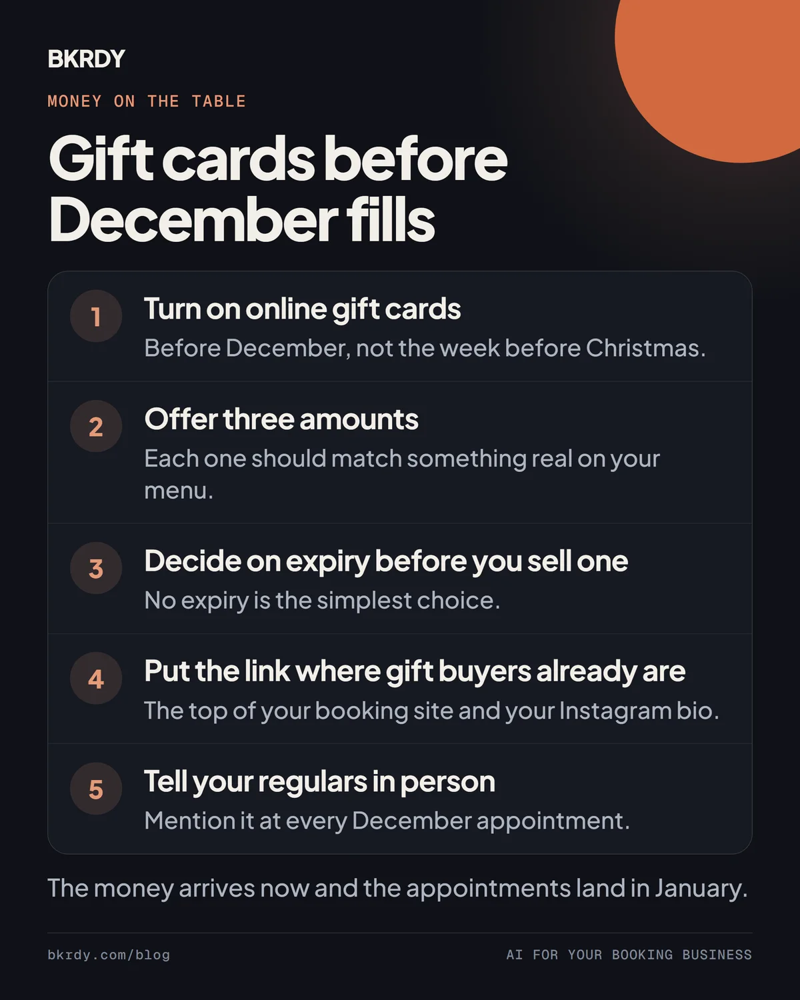

A gift card is the one thing you can sell in December without adding a single appointment to a calendar that is already full. Someone pays you now, and the work arrives in January, which for most studios is the quietest month of the year.

That is why it is worth setting up this week rather than the week before Christmas, when the people buying them have already bought something else.

:::answer
Turn on online gift cards before December, offer three amounts tied to your real services, and decide on expiry before you sell the first one. Put the link where gift buyers already look, your site and your Instagram, and tell your regulars in person. The money arrives now and the appointments land in January, so treat it as owed work, not spare cash.
:::

## Why December, and why it helps January

Gift card buyers are mostly not your clients. They are the people who love your clients and want to give them something they will actually use. They are shopping in late November and December, and they want to buy at 11pm without phoning anyone.

The appointments those cards turn into mostly come in January and February, after the holidays, when bookings thin out. So a card sold in December quietly moves work from your busiest month into your slowest one. That is the real reason to do this, more than the money arriving early.

## Pick three amounts, not ten

A buyer standing at the choice needs it to be easy. Three amounts is enough, and each should match something real on your menu, so the recipient can book a whole service rather than a fraction of one.

For example, if a fill is $55, a full set $85 and a full set with nail art $110, offer cards at $55, $85 and $110. The buyer is choosing a gift, not doing arithmetic.

You can also let people type their own amount, with a minimum and a maximum. That suits a buyer who wants to cover part of something, but it is a second decision for someone who came to make one. Start with three presets and add a custom amount only if people ask for it.

On BKRDY, gift cards are on paid plans: you turn them on, set your amounts, and the card is emailed to the person it is for, with the buyer's message, the moment it is bought. You can also add a gift card link to your site's header and change the wording of that email.

## Decide on expiry before you sell one

Pick this before the first sale, because changing the rule afterwards means two kinds of card in circulation.

The simplest choice is no expiry at all. Nobody is caught out, there is nothing to explain, and you never have the conversation with someone holding a card from two years ago.

If you do want one, know that gift card expiry is regulated, federally and by state, so check the rules that apply to you before you set it. Whatever you choose, say it plainly where people buy.

## Put the link where gift buyers already are

The buyer is usually a partner, a friend or a parent, and they will not find a gift card hidden three clicks into your site. Put it where they are already looking.

- **The top of your booking site.** A link in the header, visible on a phone without scrolling.
- **Your Instagram.** One post in late November and a reminder in mid December, plus the link in your bio for the month.
- **In person.** Mention it at every December appointment. "If anyone asks what to get you, I do gift cards" is a sentence most clients are glad to pass on.
- **At the counter.** A small sign with your booking link or a QR code for anyone who walks in.

Tell people by hand. A message to a few regulars who you know buy gifts is worth more than a broadcast nobody opens.

## The holiday offer that costs you no discount

A discount on a gift card is a discount on work you will do in January at full effort. There is a better offer: a bonus card.

Someone buys a $100 card, and you give them a separate $20 card on top, to keep or give away. They feel they got $120. You took $100 now, and the extra $20 is for a future visit, often from a new client, in a quiet month.

You give the bonus card by hand after the sale, so set an end date for the offer and stick to it. The trade-off is real: it is still $20 of work you will not be paid for, so only do it if your January really is slow. If your January is full, skip the offer and just sell the cards.

## Tell buyers when the card arrives

A buyer giving a gift on Christmas morning does not want the card in the recipient's inbox on the 12th. Tell them how it works before they pay.

If your cards are emailed when they are bought, the easy fix is for the buyer to put their own email in, then print it or forward it on the day. One line on your gift card page saves you a lot of awkward messages.

## The part to be honest with yourself about

Gift card money is money you have collected but not earned yet. Every card is an appointment you owe. If you spend December's gift card money in December, January arrives with a full book and no money for the month.

The simple habit is to keep a running total of the cards you have sold and not yet seen redeemed, so you always know what you owe. And plan for the January rush: those cards come in all at once, often in the first two weeks, so leave room for them rather than filling January with your usual bookings before they land.

Here is a post you can use this week. Change the amounts and the dates to your own.

:::copy Gift card post
Gift cards are open for the holidays. Choose $55, $85 or $110, and it goes straight to them by email with your message.

Buying for Christmas morning? Put your own email in and forward it on the day.

Link in bio. Thank you for supporting a small studio this year.
:::

## Questions

### How do I sell gift cards for my salon?

Turn on online gift cards on your booking site, offer three amounts that match real services, decide on expiry first, and put the link in your site header and your Instagram bio. Mention it at every December appointment.

### What amounts should salon gift cards be?

Match them to services on your menu, so the person receiving one can book a whole service. Three amounts is enough. Add a custom amount only if buyers ask for it.

### Should salon gift cards expire?

No expiry is the simplest choice and avoids any awkward conversation later. If you want one, gift card expiry is regulated federally and by state, so check the rules before you set it.
