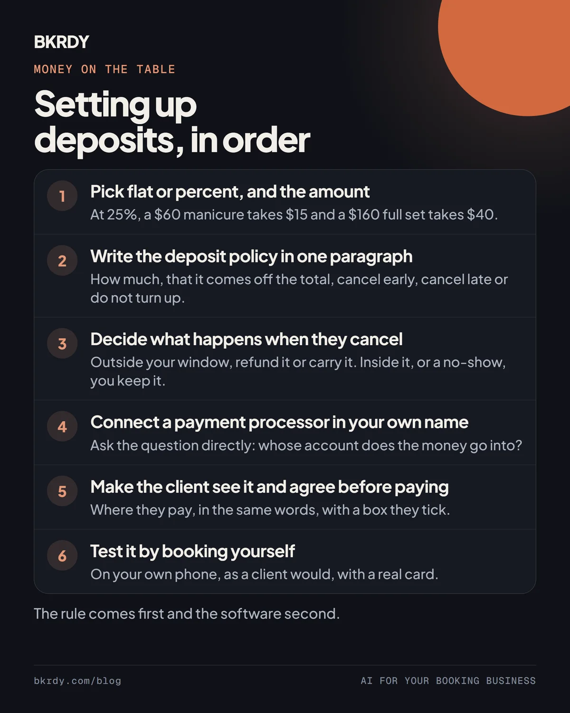

Setting up deposits takes an afternoon, and the order matters more than the software. Decide the rule, write it down, connect the payments, then book yourself as a client and watch what happens.

Most deposit trouble comes from doing it the other way round: switching on a card field first and writing the policy after the first argument about it.

:::answer
To set up deposit payments for appointments, pick flat or percent and the amount, write a one-paragraph deposit policy, decide what happens when a client cancels inside and outside your window, connect a payment processor in your own name, make clients see and agree to the policy before they pay, and book yourself once to test it. The rule comes first and the software second.
:::

If you want to know what happens to the money once it moves, that is covered in [how deposits work for appointments](/blog/how-deposits-work-for-appointments/). This one is the setup.

## 1. Pick flat or percent, and the amount

A flat deposit is the same amount on every booking, say $20. It is easy to say out loud and easy for a client to remember. It suits a menu where the prices sit close together.

A percent deposit scales with the price. At 25%, a $60 manicure takes $15 and a $160 full set takes $40. It suits a menu that runs from quick services to long ones, because a flat amount that protects the long ones feels heavy on the short ones.

Check how your booking tool handles this before you decide. Some let you set an amount per service. BKRDY uses one studio-wide rule, flat or percent, on every priced service, so if your menu runs from a $25 brow wax to a $200 set, percent is the one that fits both.

For the amount, ask what a missed slot costs you: the hour you cannot refill, plus anything you ordered for it. Enough that it is a real commitment, not so much that a new client stops at the card field. Very small deposits rarely pay, because card processors take a small fixed fee on every charge, however small. The [deposit amount guide](/guides/how-much-deposit-to-charge/) breaks it down by service price.

## 2. Write the deposit policy in one paragraph

Before anything is connected, write it down. Four facts cover it: how much, that it comes off the total, what happens if they cancel early, and what happens if they cancel late or do not turn up. Add one line on reschedules, or you will be deciding it in a message thread.

:::copy Deposit policy for your booking page
A deposit of 25% secures your appointment and comes off your total on the day. If you cancel or reschedule more than 24 hours ahead, your deposit moves to your new appointment, once. If you cancel inside 24 hours, or miss the appointment, the deposit is kept. You pay the rest after your service.
:::

## 3. Decide what happens when they cancel

The policy states the rule. You still need to decide how you will run it, because the money is already in your account and nothing comes back on its own.

- **Outside your window.** Either refund it or carry it to the next booking. Carrying it is less work and keeps the client, so pick that as your default and refund when they ask.
- **Inside your window, or a no-show.** You keep it. That is what the window is for.
- **The exception.** A genuine emergency, a first miss from a two-year regular. Decide now who is allowed to make that call, so it is not whoever answers the phone.

## 4. Connect a payment processor in your own name

The deposit should land in an account in your name, with your business details and your bank. That way you see every charge and every dispute, payouts follow your own schedule, and if you ever change booking software the account and its history stay with you.

Some platforms take customer payments into their own merchant account and pay you out later. Ask the question directly before you commit: whose account does the money go into? BKRDY takes deposits through your own Stripe account, with no markup on top of Stripe's own rate.

Give this step a few days. A processor asks for identity details and a bank account before it pays you out, and sometimes asks for more. Get it approved before you tell anyone deposits are coming.

## 5. Make the client see it and agree before paying

A policy hidden on an About page does not count. It has to sit where they pay, in the same words, with a box they tick to say they have read it. Then it goes in the confirmation email too.

Tell your existing clients before you switch it on. A regular who meets a card field without warning feels accused of something. A regular who was told a week ago does not.

:::copy Message to regulars before deposits start
Hi Tasha, a quick heads up: from Monday the 7th, new bookings take a 25% deposit that comes off your total on the day. Nothing changes for appointments you already have. The full policy is on my booking page. Thank you for being one of the people who always turns up.
:::

## 6. Test it by booking yourself

Book yourself on your own phone, as a client would, with a real card, on your cheapest service. Then check:

1. The policy appears before the payment, in the words you wrote.
2. The amount is right, and the page says it comes off the total.
3. The charge shows in your processor dashboard against your account.
4. The confirmation email repeats the policy.
5. Cancel through the client's own link and refund yourself, so you know where the button is.

Expect a few cents of processing to stay gone after a refund, depending on your processor. That is the price of the test, and it is cheap.

## The trade-off

Some people will not book once a card is required. A few of them were going to miss the appointment anyway, and some were simply new and nervous. You will not be able to tell which was which.

If your book is thin, that cost is real. An empty Tuesday is worse than a no-show on a Tuesday you would never have filled. In that case start with a small flat amount, watch which slots still get missed, and raise it once the gaps are protected rather than empty. If your tool applies one rule to the whole menu, a low percent is the gentler start, because it stays small on your short services.

## Questions

### How do I take a deposit if clients book by message?

Send a payment link from your processor before you confirm the slot, with the policy pasted above it, and only put the appointment in your calendar once it is paid. It works, but it is a step you do by hand for every booking, which is the main reason people move to a booking page that takes it at the same moment.

### Should a deposit be refundable?

Refundable outside your cancellation window, or carried to the next booking, and kept inside it or on a no-show. That split is fair to both sides: the client can change plans with notice, and you are covered when it is too late to refill the slot.

### Do I need to tell existing clients before I start taking deposits?

Yes. A short message a week ahead, with the date it starts and a line saying booked appointments are not affected, turns a surprise into a policy. It also gives the few who object a chance to say so before they meet the card field.
