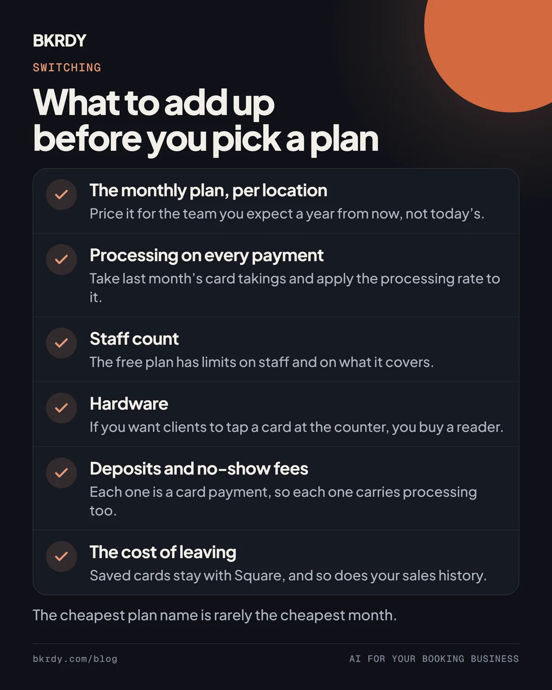

Square Appointments has a plan that costs nothing a month, and that is true. It is also the least useful number on the pricing page. What a beauty business really pays Square is decided by the card processing on every payment, how many people are on the calendar, and whether you want a reader on the counter.

So the honest way to price it is to start from last month's takings, not from the plan names.

:::answer
Square Appointments has a free plan with limits on staff and features, and paid plans that cost more per month and per location as you add staff and features, plus card processing on every payment. For most beauty businesses the processing is the bigger number, because it grows with everything you take. Square genuinely suits a business that already sells retail in person and wants a card reader; a service-only pro should price it against the alternatives.
:::

## How the pricing is shaped

Square Appointments comes in tiers, and the shape has been steady even as the numbers move:

- **A free plan**, aimed at a business starting out, with the core booking calendar and online booking, and limits on what it covers.
- **Paid plans**, a monthly fee per location, that add staff calendars, more control over who works when, and extra features such as resource booking or deeper reporting.
- **Card processing on every payment**, a percentage plus a small fixed amount, with different rates for a card tapped in person, a payment online, and a card number typed in by hand.
- **Hardware**, sold separately, if you want a reader on the counter or a full register.

Square changes its prices and what each tier includes, so do not trust a figure from an article, this one included. Check the current price on Square's own site for the tier you would be on.

> The plan is the number you compare. The processing is the number you actually pay.

## What really decides your monthly cost

**Processing on every payment.** This is the big one. Take last month's card takings and apply the processing rate to it. A worked example, with round numbers that are not Square's: say you take $6,000 by card in a month at a rate around three percent. That is about $180, every month, before the plan costs anything. A free plan with that processing is not free; it is a $180 bill with a different name.

**Staff count.** The free plan has limits on staff and on what it covers. As the team grows, a paid plan becomes the realistic one, and the fee is per location. Check where the free plan stops on Square's own site. Price it for the team you expect a year from now, not today's.

**Hardware.** If you want clients to tap a card at the counter, you buy a reader. That is a one-time cost, but a real one, and a register setup costs more.

**Deposits and no-show fees.** Each one is a card payment, so each one carries processing too. Worth knowing before you set a deposit on every service.

**The cost of leaving.** With Square, the software and the merchant account are one company. Saved cards stay with Square, and so does your sales history. That is not a monthly fee, but it is part of the price.

## Who Square genuinely suits

Square is a payments company first, and that is its strength, not a criticism.

- **You already sell retail in person.** A barbershop with a product wall, an esthetician selling skincare, a salon selling gift cards over the counter. Booking inside the account that already holds your inventory and sales is genuinely simpler.
- **You want a card reader.** If clients pay at the counter by tapping a card, Square's hardware is mature and easy.
- **You run more than one business through one account.** Appointments, a shop and a pop-up, all in one set of reports.

It suits you less if you are a service-only pro: no till, no retail, clients who pay online or by link. Then you are buying a register you never open, and the booking page is Square's layout, functional rather than designed. The [comparison with GlossGenius](/blog/glossgenius-vs-square/) goes deeper on that side.

## The honest comparison with a site of your own

If you are pricing Square against a booking site of your own, compare like with like, monthly against monthly.

The BKRDY plans: the Free plan is $0, with no card needed. Solo is $18 a month billed annually, or $21 month to month. The Studio plan, for up to six staff, is $29 a month billed annually, or $34 month to month. Studio+ covers up to twelve staff. It is $47 a month billed annually, or $55 month to month. Salon is quoted. Paid plans have a seven day trial with a card, and texts are unlimited on all of them.

What that buys is different from Square. Client payments run through your own Stripe account, with no BKRDY markup on Stripe's own rate, so you still pay processing, just to Stripe. There is no card reader and no register: payment links, saved cards, and marking cash as paid. If a reader on the counter is how your clients pay, Square is the better fit, and that is a real reason to stay.

For the wider field, the [Square Appointments alternatives](/compare/square-appointments-alternative/) page lays out the options side by side.

## Do this before you pick a plan

Twenty minutes with last month's numbers settles it.

:::copy What to add up before you pick a Square Appointments plan

1. The monthly plan for my staff count a year from now, per location, from Square's own site today.
2. Last month's card takings, split into in person, online and typed in by hand.
3. The processing rate for each of those, applied to last month's takings.
4. Any hardware I would buy: a reader, a stand, a register.
5. Any add-ons or extra features I would switch on.
6. What I would lose if I left: saved cards, sales history, the booking link.

:::

Add one, three, four and five for the monthly cost, spread the hardware over a year, and set that number beside the same sum for anything else you are considering. The cheapest plan name is rarely the cheapest month.

## Questions

### Is Square Appointments free?

There is a free plan, with limits on staff and features. You still pay card processing on every payment, and you pay for hardware if you want a reader. As the team grows, a paid plan with a monthly fee per location usually becomes the realistic choice.

### What are Square Appointments fees?

The main fee is card processing: a percentage of each payment plus a small fixed amount, with different rates in person, online and for a card typed in by hand. Paid plans add a monthly fee. Square changes its rates, so check the current ones on its own site.

### Is there a Square Appointments app?

Yes. Square has an app for running your calendar and taking payments from a phone or tablet, and clients book through your Square booking page. The app is included with the plans; the reader that lets clients tap a card is sold separately.
