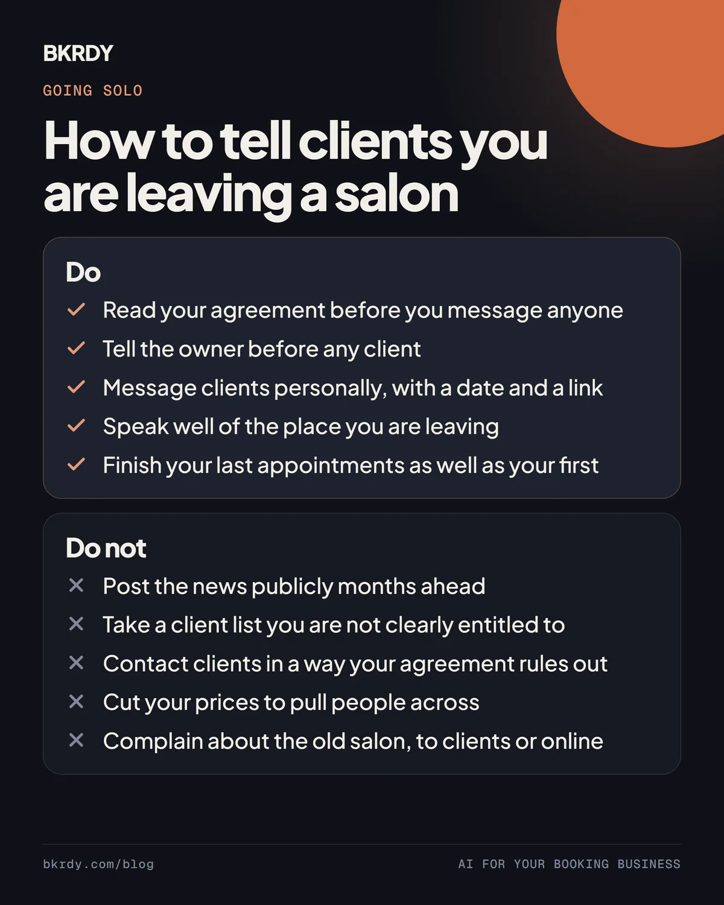

Tell clients you are moving in a short, warm message that says where you are going, when, and how to book, sent personally and close to the date. Before you write a word, though, read your own agreement with the salon you are leaving. What you may say, and to whom, may already be decided there.

Most of the damage in a move has nothing to do with the new chair. It comes from the way the old one was left: a public post months early, a client list taken without thinking, an owner who heard the news from a client. Each of those can follow you.

:::answer
Read your agreement first, then tell the salon owner before any client. Tell clients personally, a week or two before your last day and only in the ways your agreement allows, with your new location, your first open date and a link to book. Keep it short, speak well of the old place, and do not take anything you are not clearly entitled to.
:::

## Read your agreement before you message anyone

Booth rental agreements, employment contracts and commission arrangements sometimes include terms about clients, notice, or where you can work afterwards. Some say nothing. Some say a great deal.

What those terms mean for you is not something an article can answer. It depends on the exact wording and on your state's rules. Read the agreement properly, start to finish, and if anything about contacting clients or working nearby is unclear, that is a question for a lawyer before you send a message, not after.

Also check who holds what. Client details kept in the salon's own system may be theirs. Clients who text you directly on your own phone are a different situation. Know which list you are working from.

## Tell the owner first

Whatever your agreement says, the salon owner should hear it from you, before any client does. Clients talk, and an owner who learns you are leaving from a client will make your last weeks harder than they need to be.

Give the notice your agreement asks for, or a reasonable one if it says nothing. Do it in person if you can, keep it simple, and do not use the conversation to air grievances. You may want a reference, a smooth handover of your last appointments, or simply not to be the story everyone tells for the next year.

## Then tell clients, close to the date

Timing matters more than wording. Tell clients too early and you have weeks of awkward appointments in a chair everyone knows you are leaving. Tell them too late and some have already rebooked at the old place, with someone else.

A week or two before your last day, for the clients you are free to contact, is a sensible window for most moves. Clients booked with you in your final weeks can hear it in the chair, which is the warmest way anyone will hear it.

## What to say

The message needs four things: that you are moving, where, when you start, and how to book. Not why. Not a review of the old salon.

:::copy Moving announcement for your clients
Hi Simone, some news: I am moving to a new space, and my last day at the current salon is Saturday the 14th.

From Tuesday the 17th I will be at [new studio name and street]. Same work, and booking is simple: [your booking link]

I have loved doing your nails and I hope to see you there. If you would rather I book you in, just reply with a week that suits.
:::

Send it one at a time, by name, where you can. A personal message reads as a relationship. A group post reads as an advert.

## Where to send them

Clients need one place to land, and it should be yours, not a page that belongs to the salon you are leaving. Have your booking link working before the first message goes out: real services, real prices, open dates from your first day.

Put the same link in your bio, on your new card and in the message itself. A BKRDY booking page lives at yourname.bkrdy.me, so the link stays yours whichever chair you are in next. If you are weighing renting against staying on a split, run the [booth rent vs commission](/blog/booth-rent-vs-commission/) numbers first, and the [guide for solo beauty pros](/guides/booking-app-for-solo-beauty-pros/) covers what a one-person setup needs.

## Do and do not

Do:

- Read your agreement before you message anyone.
- Tell the owner before any client.
- Message clients personally, with a date and a link.
- Speak well of the place you are leaving.
- Finish your last appointments as well as your first.

Do not:

- Post the news publicly months ahead.
- Take a client list you are not clearly entitled to.
- Contact clients in a way your agreement rules out.
- Cut your prices to pull people across.
- Complain about the old salon, to clients or online.

On prices: a move is an odd time to cut them, because it tells your best clients the new place is worth less. If you want to thank people for following you, a small gesture at their first appointment lands better than a discount in the announcement.

## Not everyone will follow, and that is fine

The honest part: some clients will stay at the old salon. It may be closer to their work, they may like the front desk, or they may simply not want to change. Chasing them does more harm than letting them go.

Send one message. If they do not reply, leave it. One more, a few weeks later and only where your agreement allows contact, is the limit. Clients remember who made the move easy for them, and the ones who come later often come because you did not push.

## What to do this week

1. Read your agreement, start to finish, and note anything about clients or notice.
2. Decide your last day, your first day and the gap between them.
3. Get your booking link working with your services and prices.
4. Write the announcement and save it, unsent, until the owner has heard.

## Questions

### How far in advance should I tell clients I am leaving a salon?

For most moves, a week or two before your last day, after the owner has heard it from you and only to the clients your agreement lets you contact. Earlier than that makes your final weeks awkward and gives the salon time to rebook your clients with someone else.

### Can I take my clients with me when I leave a salon?

That depends on your agreement and your state's rules, so read the agreement and, if it is unclear, ask a lawyer. Whether you may contact clients, and with which details, is the part to check before anything else.

### What should I say when I tell clients I am moving?

That you are moving, where to, when you start, and how to book. Keep it short and warm, say nothing negative about the old salon, and send it personally rather than as a group post.
