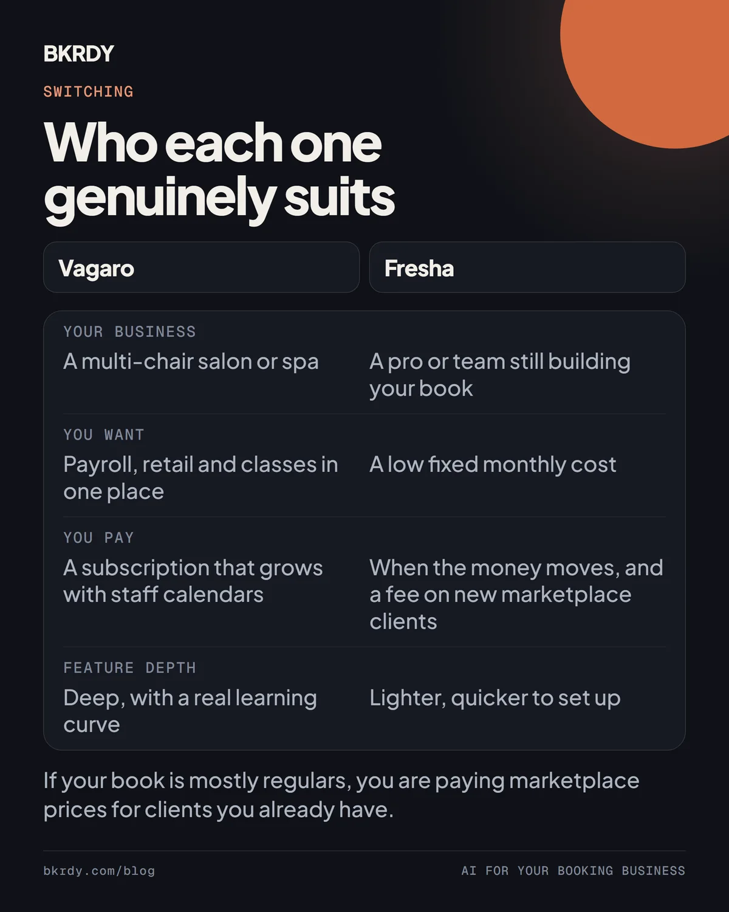

Vagaro and Fresha both put you in front of clients searching for a service nearby, and both want to take your card payments. Where they differ is where they make their money, and that is the comparison that matters. Vagaro charges you to run your business. Fresha has mostly charged you when money moves and when it sends you someone new.

Which shape costs less depends on your book, not on either company's homepage.

:::answer
Vagaro suits a salon or spa with staff that wants deep features and a subscription that grows with each calendar. Fresha suits a pro or team that wants a low fixed cost and is happy to pay per payment and per new marketplace client instead. If most of your clients are regulars who already know where to find you, neither marketplace is earning much, and a booking page of your own may be the better answer.
:::

## How each one makes its money

Vagaro is a subscription business. You pay a monthly fee that grows as you add staff calendars, and more again for add-ons such as marketing tools, payroll or a branded website. Card payments run through Vagaro's own processing, at a percentage of each payment. The marketplace listing has come with the account rather than being charged per client, which is worth confirming on the day you sign up.

Fresha built its name on booking software with no subscription. It earned from card processing on payments taken through it, and from a fee on the first booking of a client its marketplace brought you, a share of that appointment rather than a flat charge. It has since added paid plans, so the old "free" label may no longer describe the deal you would get.

Both change prices, tiers and fee rules, so do not trust a number from an article, this one included. Price each from its own site, for the staff count you expect a year from now, and add the processing to last month's takings.

> One charges you for the software. The other charges you when the money moves.

## The marketplace trade-off is the same on both

A marketplace is a search engine for clients. Someone types "braids near me" or "fade" into the app, and your profile comes up next to the shop down the road. When your book has gaps, that is genuinely useful: new clients who never saw your Instagram.

The cost arrives once you are busy. Regulars start booking through the listing because it is the link they saved, and on Fresha a fee can follow any client the platform counts as new. You are also shown beside your competitors every time someone looks you up.

So the question on both is the same: how many of last month's new clients really found you inside the marketplace, and not through your Instagram, a friend, or a card you handed out?

## Feature depth

Vagaro goes deep. Multi-staff calendars, payroll, inventory, memberships, packages, classes, forms, a front desk view, hardware. A salon with six chairs, a product wall and a Saturday class uses that depth. A solo barber opens a fraction of it and still has to learn the menus.

Fresha is lighter and quicker to set up, with the essentials a salon needs: calendar, staff, client records, payments, a marketplace profile and the basics of retail and marketing. It grows with paid extras rather than starting from a big tier.

Neither is bad. They are built at different weights.

## Side by side

| | Vagaro | Fresha |
|---|---|---|
| How it makes money | A subscription that grows with staff calendars and add-ons | Card processing and a fee on new marketplace clients, plus paid plans |
| Card payments | Through its own processing | Through its own processing |
| The marketplace | Has come with the account | The source of the new-client fee |
| Feature depth | Deep, with a real learning curve | Lighter, quicker to set up |
| What leaves with you | Your client export. Reviews, link and saved cards stay | The same |

## Who each one genuinely suits

Pick Vagaro if you run a multi-chair salon or spa, you want payroll, retail and classes in one place, and someone at the front desk will learn it properly. The subscription is predictable, and it does not grow with every new client.

Pick Fresha if you want a low fixed monthly cost, you are still building your book, and you would rather pay when the money moves than a bigger fee every month regardless. A newer stylist in a new city can do well on this shape.

If you are leaning away from both, the [Vagaro alternatives](/compare/vagaro-alternative/) and [Fresha alternatives](/compare/fresha-alternative/) pages cover the wider field. GlossGenius sits in this conversation too, and it has its own [comparison with Vagaro](/blog/glossgenius-vs-vagaro/).

## When neither is the answer

If your book is mostly regulars, you are paying marketplace prices for clients you already have. Your regulars need a link that works, a clear price list, your policies and a way to book. They do not need to see three other shops on the way.

That is the case for a booking page of your own, where nobody else is listed beside you and the link in your bio goes to you. BKRDY is built for that, with the honest limit that it is not a marketplace and will not send you strangers. If you depend on new clients finding you from a search inside an app, keep a marketplace for now.

The trade-off cuts both ways. Leaving a marketplace means the finding becomes your job: Instagram, Google, referrals, the card on the counter.

## Do this before you choose

Run this on your last thirty bookings. It takes ten minutes with your calendar open.

:::copy Ten minute check before you pick Vagaro or Fresha

1. Count how many of your last thirty bookings were genuinely new clients who found you inside a marketplace.
2. Count how many were regulars, and how many came from your own Instagram, texts or referrals.
3. Price each company's current plan for the staff you will have in a year, from its own site.
4. Add each one's processing percentage to last month's takings.
5. On Fresha, ask exactly which clients count as new for the fee, and for how long.
6. On either, export your client list and open the file before you commit.

:::

If the first number is high, a marketplace is earning its cost, and the choice between these two comes down to features and fee shape. If it is one or two, the marketplace is a cost you have stopped using.

## Questions

### Is Vagaro or Fresha cheaper?

It depends on your book. Vagaro's cost is mostly a subscription that grows with staff and add-ons. Fresha's has mostly been processing and a fee on new marketplace clients, now with paid plans too. A busy salon full of regulars and a business still building its book can get opposite answers, so price both from their own sites against last month's numbers.

### Do Vagaro and Fresha both have a marketplace?

Yes. Both list your business where clients search for services nearby. On Fresha a new client from the marketplace has been the trigger for a fee, while Vagaro has included the listing with the account. Check the current terms on each before you sign up.

### Can I take my clients with me if I leave either one?

Your client contacts, if you export them first and keep the file yourself. Your reviews, your booking link and your clients' saved cards stay with the platform.
